# Forensic Backend Audit — Personal OS (Deku / Pos-Deku)

## 1. Executive Summary

The Personal OS backend is a well-structured Python TUI application with a clear
separation between core data logic (`core/`) and TUI presentation (`tui/`).
The architecture follows documented invariants (M3.5 baseline): capture contract
(persist-first), shell-only NavigationState, single ContextFactory path, and
component-based composition with child contexts.

**Readiness: MODERATE-HIGH.** The core capture-processing pipeline is implemented
and tested (189 tests pass). The TUI shell is functional (Today, Projects, Tasks,
Journal, Search workspaces). Key observations:

- The TUI capture input correctly calls `persist_capture()` before processing
  — the persist-first contract is honored.
- The semantic extraction path is entirely untested end-to-end (no LLM API key
  in test environment; tests only cover the regex fallback path).
- The `delete_file` method has a broken `else` branch that commits git changes
  even when `commit=False`.
- The `weekly_review.analyze()` method computes `project_hours` as an empty dict
  (never populated), making the per-project hours metric useless.
- Project alias maps exist in both `KnowledgeExtractor` (regex path) and
  `ProjectResolver` (semantic path), but the alias map is NOT passed to the
  resolver — the LLM path cannot resolve aliases like "maestro" to "Maestro".
- No API/adapter layer exists for web UI integration; the TUI and CLI are
  tightly coupled to the core via singleton `get_vault()`/`get_config()`.
- `get_provider(config)` reads `config.provider` which doesn't exist on the
  `Config` dataclass — it always defaults to "openrouter" regardless of the
  user's `model.provider` setting (F-005).
- `SemanticExtractor.extract()` re-raises on any `apply_action` failure during
  batch processing, which triggers a rollback — but `_process_entry` catches
  this and falls back to regex, so this behavior is correct (not a bug).

**Key finding**: The codebase is in a working state for local terminal use with
189 passing tests. The highest-risk issues are: F-004 (delete_file broken
else branch), F-005 (LLM provider config ignored), F-006 (weekly_review/
create_hub bypass VaultManager), and F-007 (rollback_batch can destroy
pre-existing files).

## 2. Verified Architecture

### Component Inventory

```
src/personal_os/
├── __init__.py             # Package init, __version__ = "0.1.0"
├── __main__.py             # Module entry: python -m personal_os
├── cli/
│   ├── __init__.py
│   └── main.py             # Typer CLI (pos) — note, voice, search, projects, etc.
├── core/                   # Backend logic — no TUI/Textual imports
│   ├── __init__.py
│   ├── capture.py          # Capture Contract: persist_capture, capture_and_process
│   ├── config.py           # Config dataclasses, get_config(), env overrides
│   ├── vault.py            # VaultManager: atomic writes, git, journal, projects
│   ├── processor.py        # BackgroundProcessor, KnowledgeExtractor/Applier
│   ├── search.py           # SearchEngine (ripgrep + Python fallback)
│   ├── links.py            # LinkGraph: entity extraction, related, orphans, hubs
│   ├── weekly_review.py    # WeeklyReviewGenerator: collect/analyze/render
│   ├── llm.py              # LLMProvider ABC, get_provider() factory
│   ├── llm_openrouter.py   # OpenRouterProvider (Gemma 4 31B)
│   ├── skills/
│   │   └── voice_capture.py # whisper.cpp integration, routes through capture_and_process
│   └── extraction/          # Typed extraction pipeline
│       ├── __init__.py
│       ├── models.py        # Frozen dataclasses: RawExtraction, ResolvedExtraction, etc.
│       ├── contexts.py      # ExtractionContext (passed to LLM)
│       ├── validator.py     # ExtractionValidator (structural only, no semantics)
│       ├── resolver.py      # ProjectResolver (deterministic project matching)
│       ├── project_matcher.py # ProjectMatcher ABC + SimpleProjectMatcher (difflib)
│       ├── action_planner.py # ActionPlanner (ResolvedExtraction → VaultAction)
│       ├── actions.py       # VaultAction union: CreateTask, RecordProgress, etc.
│       └── semantic_extractor.py # SemanticExtractor: LLM → Validator → Resolver → ActionPlanner
└── tui/                    # Textual TUI — presentation layer
    ├── __init__.py
    ├── app.py              # PersonalOSTUI (shell: sidebar + router + status bar + capture input)
    ├── navigation.py       # NavigationState (shell-only: active_view, history, forward_stack)
    ├── services.py         # AppServices (DI container)
    ├── context.py          # WorkspaceContext, ContextFactory
    ├── router.py           # ViewRouter (lazy view instantiation, lifecycle hooks)
    ├── views/
    │   ├── __init__.py     # VIEW_REGISTRY (only WorkspaceView subclasses)
    │   ├── base.py         # WorkspaceView contract
    │   ├── today.py        # TodayView (composed dashboard with providers)
    │   ├── projects.py     # ProjectsView
    │   ├── tasks.py        # TasksView
    │   ├── journal.py      # JournalView
    │   ├── search.py       # SearchView
    │   └── placeholders.py # Knowledge/Reviews/Favorites/Settings (stubs)
    ├── components/          # Reusable, embeddable leaf components
    │   ├── __init__.py
    │   ├── base.py         # Component ABC
    │   ├── dashboard_panel.py
    │   ├── captures_panel.py
    │   ├── tasks_panel.py
    │   ├── focus_panel.py
    │   ├── notes_panel.py
    │   ├── upcoming_panel.py
    │   ├── project_tree.py
    │   ├── journal_entry.py
    │   ├── search_results.py
    │   ├── tag_colors.py
    │   └── (planned: markdown_renderer.py, conversation_panel.py)
    ├── providers/           # Data layer between vault and views
    │   ├── journal_provider.py
    │   ├── projects_provider.py
    │   └── search_provider.py
    ├── tasks_provider.py    # Shared tasks data
    ├── big_tasks_provider.py # Project-level big task parsing
    ├── today_provider.py    # Dashboard data provider
    └── widgets/
        ├── navigator.py    # NavigatorSidebar
        └── status_bar.py   # StatusBar (app-owned)
```

### Entry Points

| Entry | File | Command |
|-------|------|---------|
| CLI | `cli/main.py` | `pos` (Typer) → subcommands: note, voice, search, projects, new-project, open, links, weekly-review, process, init, config |
| TUI | `tui/app.py` | `pos` (no args) or `PersonalOSTUI().run()` |
| Module | `__main__.py` | `python -m personal_os` |
| Voice | `skills/voice_capture.py` | `pos voice` or direct |

### Architecture Diagram (Mermaid)

```mermaid
graph TB
    subgraph "Entry Points"
        CLI["pos (Typer CLI)<br/>cli/main.py"]
        TUI["pos (TUI)<br/>tui/app.py"]
        VOICE["pos voice<br/>skills/voice_capture.py"]
    end

    subgraph "Core Backend"
        CAP["capture.py<br/>(Capture Contract)"]
        PROC["processor.py<br/>BackgroundProcessor"]
        VAULT["vault.py<br/>VaultManager"]
        CONFIG["config.py<br/>Config"]
        SEARCH["search.py<br/>SearchEngine"]
        LINKS["links.py<br/>LinkGraph"]
        REVIEW["weekly_review.py<br/>WeeklyReviewGenerator"]

        subgraph "Extraction Pipeline"
            SEM["semantic_extractor.py<br/>SemanticExtractor (LLM)"]
            MODELS["models.py<br/>(Frozen dataclasses)"]
            VAL["validator.py<br/>ExtractionValidator"]
            RES["resolver.py<br/>ProjectResolver"]
            MATCH["project_matcher.py<br/>SimpleProjectMatcher"]
            PLAN["action_planner.py<br/>ActionPlanner"]
            ACT["actions.py<br/>VaultAction union"]
        end

        LLM_ABS["llm.py<br/>LLMProvider ABC"]
        LLM_OR["llm_openrouter.py<br/>OpenRouterProvider"]
    end

    subgraph "TUI Presentation"
        NAV["navigation.py<br/>NavigationState"]
        ROUTER["router.py<br/>ViewRouter"]
        CTX["context.py<br/>WorkspaceContext"]
        SVCS["services.py<br/>AppServices"]
        TODAY_P["today_provider.py"]
        PROG_P["projects_provider.py"]
        JRNL_P["journal_provider.py"]
        SRCH_P["search_provider.py"]
        BIG_P["big_tasks_provider.py"]
    end

    subgraph "Persistent Storage (Vault)"
        JOURNAL["04-Personal/Journal/*.md<br/>(Daily Stream)"]
        PROJECTS["02-Projects/*/<br/>README.md, Tasks.md,<br/>Progress.md, Notes.md,<br/>Architecture.md, Decisions.md,<br/>Research.md, Timeline.md"]
        SKILLS["03-Skills/*/Progress.md"]
        RES_MD["05-Resources/**/*.md"]
        ARCHIVE["06-Archive/**/*.md"]
        INBOX["00-Inbox/Tasks.md"]
        TEMPLATES["Templates/"]
        GIT["Git repository<br/>(.git/ at vault root)"]
    end

    CLI -->|calls| CAP
    TUI -->|on_input_submitted| CAP
    VOICE -->|calls| CAP
    CAP -->|persist_capture| VAULT
    CAP -->|capture_and_process| PROC

    PROC -->|primary: OPENROUTER_API_KEY set| SEM
    PROC -->|fallback: regex| KNOW_EX["KnowledgeExtractor (regex)"]
    SEM -->|uses| LLM_ABS
    LLM_ABS -->|factory| LLM_OR
    SEM --> VAL
    SEM --> RES
    SEM --> PLAN
    RES --> MATCH
    PLAN --> ACT
    SEM --> MODELS
    PROC -->|KnowledgeApplier.apply_action| ACT
    PROC -->|begin_batch/commit_batch| VAULT
    PROC -->|append_semantic_block| VAULT

    PROC -->|list_projects| VAULT
    PROC -->|get_journal_entries| VAULT

    TUI -->|get_vault/get_config| VAULT
    TUI -->|BackgroundProcessor| PROC
    TUI --> NAV
    TUI --> ROUTER
    TUI --> SVCS
    SVCS --> CTX
    SVCS --> TODAY_P
    SVCS --> PROG_P
    SVCS --> JRNL_P
    SVCS --> SRCH_P
    SVCS --> BIG_P

    TODAY_P --> VAULT
    PROG_P --> VAULT
    JRNL_P --> VAULT
    SRCH_P --> SEARCH
    SEARCH --> VAULT
    BIG_P --> VAULT
    LINKS --> VAULT
    REVIEW --> VAULT

    VAULT --> GIT
    VAULT --> JOURNAL
    VAULT --> PROJECTS
    VAULT --> SKILLS
    VAULT --> RES_MD
    VAULT --> ARCHIVE
    VAULT --> INBOX
    VAULT --> TEMPLATES

    style CAP fill:#e11d48,stroke:#333,color:#fff
    style PROC fill:#2563eb,stroke:#333,color:#fff
    style VAULT fill:#059669,stroke:#333,color:#fff
    style SEM fill:#7c3aed,stroke:#333,color:#fff
    style TUI fill:#da7029,stroke:#333,color:#fff
```



### Data Flow (Capture Processing Pipeline)

```
Capture Input
    (TUI text input, CLI `pos note`, voice)
    ↓
persist_capture()  [capture.py]
    — generates ULID capture_id
    — VaultManager.append_journal_entry()
    — appends to DD-Personal/Journal/YYYY-MM-DD.md
    — atomic write, immediate git commit
    ↓
CaptureReceipt (persisted=True, capture_id set)
    ↓
BackgroundProcessor.process() or process_entry()
    ↓
_process_entry(text, source, capture_id)
    ├── If OPENROUTER_API_KEY set:
    │   SemanticExtractor.extract(text, context)
    │       → LLMProvider.extract() [OpenRouter/Gemma]
    │       → RawExtractions → Validator → Resolver → ActionPlanner
    │       → CaptureResult (items, vault_writes, errors)
    │   KnowledgeApplier.apply_action(action) for each vault_write
    │   vault.append_semantic_block(capture_id, items) [HTML comment YAML]
    │   begin_batch → commit_batch (atomic vault write group)
    └── Else (regex fallback):
    │   KnowledgeExtractor.extract(text) → extractions
    │   KnowledgeApplier.apply(extraction) for each
    └── Returns ProcessingResult
```

### Key Architectural Decisions (Verified)

1. **Persist-First Contract** (ARCHITECTURE_BASELINE.md §1, capture.py): Raw
   captures are appended to the Daily Stream before any processing. Processing
   is best-effort and decoupled. `capture.py` is the canonical entry point —
   all input paths must use it. **VERIFIED**: All three input paths (TUI, CLI,
   voice) call `persist_capture()` first.

2. **Shell-Only Navigation** (navigation.py): `NavigationState` contains only
   `active_view`, `history`, `forward_stack`. Workspace-local state
   (selected_project, etc.) is reserved for future milestones in
   `WorkspaceContext`.

3. **Single Context Factory** (context.py, services.py): `ContextFactory.build()`
   is the only path for `WorkspaceContext` creation. `AppServices.build_context()`
   wraps it. Views are recreated/freshly-contexted on every workspace switch.

4. **Component Isolation** (components/base.py): Components depend only on
   `WorkspaceContext`, never on global app state. Never in `VIEW_REGISTRY`.

5. **Typed Actions Boundary** (actions.py, action_planner.py): LLM output never
   reaches the filesystem directly. `RawExtraction` → `Validator` → `Resolver`
   → `ActionPlanner` → `VaultAction` → `KnowledgeApplier` → `Vault`.

## 3. Implementation Matrix

| Component | Status | Evidence | Tests | Gaps |
|-----------|--------|----------|-------|------|
| **Capture Contract** (capture.py) | Implemented | Lines 57-158: persist_capture, capture, capture_and_process | test_smoke, test_batch_commits | None — TUI correctly uses it |
| **BackgroundProcessor** (processor.py) | Implemented | Lines 586-744: queue, _worker, _process_entry, _process_semantic, _process_regex | test_semantic_pipeline | _process_semantic not unit-tested; no mock LLM provider in tests |
| **KnowledgeExtractor** (regex) | Implemented | Lines 49-142: patterns, _identify_project, extract, _deduplicate | test_smoke::test_process_entry_extracts | Alias map not shared with resolver (F-008) |
| **KnowledgeApplier** | Implemented | Lines 149-580: apply_action (typed) + apply (legacy dict) | test_batch_commits | Duplicate logic between typed and dict paths (F-012) |
| **SemanticExtractor** | Implemented | Lines 120-304: full pipeline orchestration | test_semantic_pipeline (uses real LLM if key set; tests assert on regex fallback) | No mock provider in tests; live API dependency |
| **OpenRouterProvider** | Implemented | llm_openrouter.py:118-294: extract, _parse, _item_to_extraction | None directly | No fallback for non-200 responses beyond raise; no rate-limit handling |
| **ExtractionValidator** | Implemented | validator.py:78-195: structural validation only | test_extraction_validator | — |
| **ProjectResolver** | Implemented | resolver.py:38-232: exact/alias/fuzzy/new/ambiguous/unknown | test_extraction_resolver | Alias map hardcoded in resolver.py:222 — not configurable from SemanticExtractor |
| **SimpleProjectMatcher** | Implemented | project_matcher.py:55-155: difflib-based | test_extraction_resolver | — |
| **ActionPlanner** | Implemented | action_planner.py:44-216: certainty-based demotion | test_semantic_pipeline | — |
| **VaultManager** | Implemented | vault.py:17-532: atomic_write, begin_batch, write_file, append_file | test_smoke, test_batch_commits, test_vault_config, test_vault_manager | delete_file broken (F-004); rollback_batch can destroy pre-existing files (F-007) |
| **TUI App Shell** (app.py) | Implemented | Lines 77-322: PersonalOSTUI, compose, on_input_submitted | test_smoke, test_tui_acceptance | on_input_submitted correctly calls persist_capture (F-001 was wrong) |
| **ViewRouter** | Implemented | router.py:22-78: show(), refresh_active() | test_tui_acceptance | — |
| **NavigationState** | Implemented | navigation.py:65-122: navigate, back, forward | test_tui_acceptance | — |
| **TodayView** | Implemented | today.py:127-275: composed dashboard with providers | test_tui_acceptance | — |
| **ProjectsView** | Implemented | projects.py: views projects with ProjectTree | test_projects_workspace | — |
| **TasksView** | Implemented | tasks.py: tasks listing | — (no dedicated test) | — |
| **JournalView** | Implemented | journal.py: journal entries with semantic display | test_journal_workspace | — |
| **SearchView** | Implemented | search.py: live search with debounce | test_search_workspace | — |
| **Knowledge/Reviews/Favorites/Settings** | Stub | placeholders.py: static text only | — | Not implemented |
| **WeeklyReviewGenerator** | Implemented | weekly_review.py: collect/analyze/render/generate | test_smoke | project_hours bug (F-006); generate() bypasses VaultManager (F-010) |
| **LinkGraph** | Implemented | links.py: entity extraction, related, orphans, hubs | test_smoke | create_hub writes directly (bypasses VaultManager) (F-010) |
| **Voice Capture** | Implemented | voice_capture.py: whisper.cpp integration | test_smoke | Hardcoded path for whisper engine (NixOS) |
| **CLI Commands** | Implemented | cli/main.py: note, voice, search, projects, links, etc. | test_smoke | `process` command re-processes journal content naively |

## 4. Persistence and Domain Model

### Sources of Truth

| Entity | Source of Truth | Format | Write Methods |
|--------|-----------------|--------|---------------|
| **Raw Captures** | `04-Personal/Journal/YYYY-MM-DD.md` | Markdown with `## HH:MM:SS - [Source: X] [cid: ULID]` headers | `VaultManager.append_journal_entry()` |
| **Semantic Metadata** | Same journal file, as `<!-- semantic:CID\nYAML -->` HTML comments | YAML inside HTML comments | `VaultManager.append_semantic_block()` |
| **Projects** | `02-Projects/<name>/` directory + 8 standard files | Markdown files | `VaultManager.create_project()`, `KnowledgeApplier._action_*` |
| **Project Tasks** | `02-Projects/<name>/Tasks.md` | `- [ ]` / `- [x]` checkboxes | `KnowledgeApplier._action_create_task`, `_mark_complete` |
| **Project Progress** | `02-Projects/<name>/Progress.md` | `- **YYYY-MM-DD**: description (Nh)` | `KnowledgeApplier._action_record_progress` |
| **Project Notes** | `02-Projects/<name>/Notes.md` | `- **YYYY-MM-DD**: description #observation` | `KnowledgeApplier._action_append_note`, `_record_problem` |
| **Decisions** | `02-Projects/<name>/Architecture.md` | `## Decision Log` section | `KnowledgeApplier._action_add_decision` |
| **Skills Learning** | `03-Skills/<area>/Progress.md` | `## Learning Log` section | `KnowledgeApplier._action_append_learning` |
| **Weekly Reviews** | `04-Personal/Reviews/weekly/YYYY-Wnn.md` | Markdown report | `WeeklyReviewGenerator.generate()` |
| **Link Graph** | Wiki-links `[[Note]]` and `#tags` in all .md files | Inline markdown | `LinkGraph.create_hub()` (writes directly) |

### Domain Model (from code)

- **CaptureReceipt** (capture.py:36): `raw`, `source`, `timestamp`, `journal_path`,
  `persisted`, `error`, `capture_id` (ULID).
- **ProcessingResult** (processor.py:37): `extractions`, `changes_made`, `errors`, `items`.
- **ExtractionResult** (semantic_extractor.py:58): `raw: RawExtraction`,
  `resolved: ResolvedExtraction`, `action: VaultAction`, `validation: ValidationResult`.
- **CaptureResult** (semantic_extractor.py:75): `source_text`, `capture_id`, `items`, `errors`.
- **ProjectDetail** (providers/projects_provider.py:39): name, path, status, health,
  last_activity, open_tasks, total_hours, description, next_task, milestone, progress,
  big_tasks, documents.
- **JournalEntry** (providers/journal_provider.py:33): time, source, capture_id,
  content, raw, semantic_items, has_semantic.

### Write Ownership

- **Single writer for journal entries**: `VaultManager.append_journal_entry()`
  is the only method that writes to the Daily Stream.
- **Single writer for project files**: `KnowledgeApplier` (via typed and legacy
  paths) writes all project-level files (Tasks.md, Progress.md, Notes.md, etc.).
- **Single writer for semantic blocks**: `VaultManager.append_semantic_block()`.
- **Weekly reviews**: `WeeklyReviewGenerator.generate()` writes directly via
  `Path.write_text()` — does NOT use `VaultManager.write_file()` (F-010).
- **Hubs**: `LinkGraph.create_hub()` writes directly via `Path.write_text()` —
  does NOT use `VaultManager` (F-010).

### Consistency Mechanisms

- **Atomic writes**: `VaultManager.atomic_write()` uses `tempfile` + `replace()`.
- **Batch commits**: `begin_batch()` → stage writes → `commit_batch()` (single
  git commit) or `rollback_batch()` (discard staged changes). Used for semantic
  processing writes. Journal writes bypass batch mode (persist-first).
- **ULID capture_id**: Links raw journal entry to semantic block and to
  cid tags in vault writes (`*(cid: XXXX)*`).
- **Git integration**: All writes go through `self._repo.index.add()` + commit.
  Journal writes suspend batch mode if active.

### Consistency Risks

- `delete_file` has a broken `else` branch (F-004): when `commit=False`, it
  removes from git index but then commits anyway.
- `rollback_batch` removes files written during the batch (F-007) but does not
  handle files that existed before the batch and were modified — it only
  `unlink()`s files in `_batch_files`, which includes ALL files written during
  the batch (including modifications, not just new files), which could delete
  pre-existing content.
- No unique constraint on capture_id in the journal — two simultaneous captures
  could produce the same journal entry header (ULID makes this unlikely).

## 5. Verification Results

### Commands Executed

```
PYTHONPATH=src uv run python -m pytest tests/ -x --tb=short -q
→ 189 passed in 8.70s

PYTHONPATH=src uv run python -m pytest tests/ -v --tb=short
→ 189 passed in 7.88s

python -c "import ast; check all .py files for syntax errors"
→ No syntax errors found
```

### Test Inventory

| File | Tests | Type |
|------|-------|------|
| test_smoke.py | 10 | Integration (real vault + services) |
| test_tui_acceptance.py | 1 | Integration (Textual pilot) |
| test_semantic_pipeline.py | 19 | Integration (regex fallback, no LLM key) |
| test_extraction_resolver.py | 16 | Unit |
| test_extraction_validator.py | 12 | Unit |
| test_batch_commits.py | ~20 | Integration |
| test_journal_workspace.py | ~30 | Integration (Textual + unit) |
| test_search_workspace.py | ~15 | Integration (Textual + unit) |
| test_projects_workspace.py | ~10 | Integration (Textual + unit) |

**Total: 189 tests, all passing.**

### Coverage Evidence

- Tests use isolated temp vaults (`conftest.py:38` `isolated_vault` fixture).
- Singletons are reset between tests (`_reset_singletons`).
- No coverage.py or `--cov` configuration found in `pyproject.toml`.
- Tests exercise the **real implementation** against temp vaults — no heavy
  mocking of core services (per test_smoke.py docstring: "No heavy mocking").
- The semantic pipeline tests use the **regex fallback path** — `OPENROUTER_API_KEY`
  is explicitly popped from the environment (`test_smoke.py:112`).
- The `OpenRouterProvider` and the full LLM semantic path are **not tested** —
  they require a live API key and network access.

### Limitations

- No coverage measurement tooling is configured.
- No integration test for the LLM semantic path (requires `OPENROUTER_API_KEY`).
- No test for the `pos note` → `capture_and_process` → LLM path end-to-end.
- No test for concurrent vault access or batch rollback failure scenarios.
- No test for `delete_file` with `commit=False`.
- No test for `WeeklyReviewGenerator.analyze()` metrics output.

## 6. Findings Register

### F-001 — (WITHDRAWN) TUI capture input bypasses persist-first contract

- After re-examination, `tui/app.py:283` correctly calls
  `persist_capture(text, source="Text", vault=self.vault)` before
  `self.processor.process()`. The persist-first contract is honored.
- This finding was incorrectly reported. No action needed.

### F-002 — (CORRECTED) Project alias maps exist but aren't shared between regex and LLM paths

- **Severity**: Medium
- **Evidence**: `processor.py:95-105` defines `project_aliases` for the regex
  `KnowledgeExtractor` (e.g., `"maestro": "Maestro"`, `"router": "Maestro"`).
  `resolver.py:222-232` defines `DEFAULT_ALIASES` with similar mappings.
  However, `_process_semantic()` (processor.py:689) creates
  `SemanticExtractor(provider=provider)` without passing any alias map. The
  `SemanticExtractor` creates a `ProjectResolver` (resolver.py:130) without
  aliases. So the LLM path cannot resolve aliases like "maestro" to "Maestro".
- **Impact**: If `OPENROUTER_API_KEY` is set, project aliases won't resolve in
  the semantic path — the LLM says "maestro" but the resolver can't match it.
  Only the regex fallback path has alias support.
- **Confidence**: Verified.
- **Resolution**: Pass aliases to `ProjectResolver` in `SemanticExtractor` or
  make `DEFAULT_ALIASES` the default for `ProjectResolver.__init__()`.

### F-003 — (WITHDRAWN) Batch rollback re-raises, losing the regex fallback

- After re-examination, `_process_entry()` (processor.py:655-664) DOES catch
  exceptions from `_process_semantic()` and falls back to `_process_regex()`.
  The `raise` at line 710/722 in `_process_semantic()` is caught by the
  `except Exception as exc:` at line 658, which logs a warning and calls
  `_process_regex()`. This is correct behavior.
- **Severity**: Low (informational — the `raise` statements are intentional
  to trigger rollback + outer catch).
- **Resolution**: None needed.

### F-004 — `delete_file` has broken logic for `commit=False` (VERIFIED)

- **Severity**: Medium
- **Evidence**: `vault.py:238-253` — `delete_file(path, commit=True)`:
  - If `commit=True`: removes from git index + commits.
  - If `commit=False` (else branch): removes from git index + commits anyway
    (lines 250-253 run `self._repo.index.remove()` + `.commit()` even when
    `commit=False`). The `else` should only `path.unlink()` without git staging.
  - Also: the method body has excessive indentation (the docstring at line 239
    and the `if` at line 240 are indented with 12 spaces instead of 8,
    suggesting this was copy-pasted or edited hastily).
- **Impact**: Calling `delete_file(path, commit=False)` still stages and commits
  the deletion to git, contrary to the caller's intent.
- **Confidence**: Verified.
- **Resolution**: Fix the `else` branch to only unlink without git operations.
  Fix indentation.

### F-005 — `get_provider()` ignores `model.provider` config (VERIFIED)

- **Severity**: Medium
- **Evidence**: `llm.py:48-68` — `get_provider(config)` calls
  `getattr(config, "provider", "openrouter")` (line 62). But the `Config`
  dataclass (`config.py:132-141`) has NO `.provider` attribute — the provider
  field is at `config.model.provider` (ModelConfig, line 50, defaults to
  `"local"`). So `getattr(config, "provider", "openrouter")` ALWAYS returns
  `"openrouter"` (the default), regardless of what the user configured.
  Similarly, `getattr(config, "model_name", ...)` (line 65) reads
  `config.model_name` which doesn't exist — it should be `config.model.model_name`.
  And `getattr(config, "base_url", ...)` (line 66) should be
  `config.model.base_url`.
- **Impact**: The LLM provider is always OpenRouter, regardless of the user's
  `model.provider` setting in config.toml. Custom `base_url` and `model_name`
  settings are also ignored. The `OPENROUTER_API_KEY` check in
  `_process_entry()` still gates whether the semantic path runs at all, so this
  bug only manifests when the key IS set — the user can't switch to a local or
  OpenAI provider.
- **Confidence**: Verified.
- **Resolution**: `get_provider` should accept a `ModelConfig` object (not the
  full `Config`), or the caller should pass `config.model` instead of `config`.
  Fix: change `processor.py:673` to `provider = get_provider(config.model)`,
  and update `get_provider` to use `getattr(model_config, "provider", "openrouter")`,
  `getattr(model_config, "model_name", ...)`, `getattr(model_config, "base_url", ...)`.

### F-006 — `weekly_review.analyze()` never populates `project_hours` (VERIFIED)

- **Severity**: Low
- **Evidence**: `weekly_review.py:199-230` — `analyze()` initializes
  `project_hours: Dict[str, float] = {}` (line 201) but never adds entries.
  The loop at line 211-221 parses hours from journal entries (`total_hours`)
  and counts project mentions, but never associates hours with specific projects.
  The `project_hours` dict remains empty and is returned in the metrics (line 225).
- **Impact**: The "project_hours" metric in the weekly review is always empty
  `{}`. Users can't see how many hours they spent per project.
- **Confidence**: Verified.
- **Resolution**: Parse project-specific hour mentions in the journal entry
  content (e.g., "2 hours on Maestro") and accumulate into `project_hours`.

### F-007 — `rollback_batch` can delete pre-existing files (LIKELY)

- **Severity**: Medium
- **Evidence**: `vault.py:190-209` — `rollback_batch()` iterates
  `self._batch_files` (line 204) and calls `file_path.unlink()` on each (line 206).
  But `_batch_files` is appended to in `write_file()` (line 220:
  `self._batch_files.append(path)`), which tracks ALL files written during batch
  mode — including modifications to pre-existing files, not just new files.
  If `rollback_batch()` is called after modifying a pre-existing file, it will
  `unlink()` the file, destroying its original content.
- **Impact**: A failed semantic processing batch could destroy existing project
  files (Tasks.md, Progress.md, Notes.md, etc.) that were modified during the
  batch, not just newly created files.
- **Confidence**: Likely — the code path exists but no test triggers rollback
  with pre-existing files. `test_batch_commits.py` tests rollback but only
  with newly created files.
- **Resolution**: `rollback_batch` should use `git checkout` to restore
  pre-existing files to their pre-batch state, and only `unlink()` truly new
  files. Alternatively, snapshot file contents before the batch begins.

### F-008 — Duplicate alias definitions across `KnowledgeExtractor` and `ProjectResolver` (VERIFIED)

- **Severity**: Low
- **Evidence**: `processor.py:95-105` defines `self.project_aliases` with keys
  like `"maestro"`, `"router"`, `"drone"`, etc. `resolver.py:222-232` defines
  `DEFAULT_ALIASES` with the same keys and values. These are independent
  constant definitions — if one is updated and not the other, the two paths
  will diverge. The `KnowledgeExtractor._identify_project()` uses its own
  `self.project_aliases`, while `ProjectResolver.__init__()` has its own
  `DEFAULT_ALIASES` default.
- **Impact**: Maintenance burden; risk of alias divergence between regex and
  semantic paths.
- **Confidence**: Verified.
- **Resolution**: Extract to a single shared constant (e.g., in
  `extraction/models.py` or `config.py`).

### F-009 — `SemanticExtractor.extract()` does not check for duplicate `capture_id` in semantic block (LIKELY)

- **Severity**: Low
- **Evidence**: `semantic_extractor.py:120-304` — `extract()` calls
  `vault.append_semantic_block()` which appends a `<!-- semantic:CID\nYAML -->`
  block to the journal. If the same capture_id is processed twice (e.g., retried
  after a batch rollback), the semantic block would be appended twice. There
  is no guard against this.
- **Impact**: Duplicate semantic blocks in the journal after a retry. Low
  severity since capture_id is a ULID (unlikely to collide) and the rollback
  discards the first attempt's writes.
- **Confidence**: Likely.
- **Resolution**: Add idempotency check in `append_semantic_block()` — skip
  if a semantic block with the same capture_id already exists.

### F-010 — `WeeklyReviewGenerator.generate()` and `LinkGraph.create_hub()` bypass VaultManager (VERIFIED)

- **Severity**: Medium
- **Evidence**:
  - `weekly_review.py:388` uses `output_file.write_text(document, encoding="utf-8")`
    instead of `self.vault.write_file()`. This means the review file is NOT
    atomic (no tempfile + rename), NOT git-tracked (no index.add + commit),
    and NOT batch-mode-aware.
  - `links.py:220` (approx) uses `hub_file.write_text(...)` in `create_hub()`
    instead of `self.vault.write_file()`.
- **Impact**: Weekly reviews and hubs are written without atomicity guarantees,
  no git tracking, and could result in partial writes on crash. Git history
  does not include review/hub changes.
- **Confidence**: Verified.
- **Resolution**: Route both through `VaultManager.write_file()`.

### F-011 — `KnowledgeApplier.apply()` and `apply_action()` contain duplicate logic (VERIFIED)

- **Severity**: Low
- **Evidence**: `processor.py:162-208` (`apply_action`, typed path) and
  `processor.py:411-563` (`apply`, legacy dict path) implement nearly identical
  logic for the same operations (create task, record progress, add decision,
  mark complete, append learning, append note). The typed path uses
  `VaultAction` dataclass fields; the legacy path reads from dict keys. Both
  call `self.vault.write_file()` with the same patterns.
- **Impact**: Maintenance burden — changes to file-writing logic must be applied
  in two places. Risk of divergence.
- **Confidence**: Verified.
- **Resolution**: Have `apply(dict)` convert to typed `VaultAction` and delegate
  to `apply_action()`.

### F-012 — No dedicated tests for `delete_file`, `append_file`, `get_journal_entries` (VERIFIED)

- **Severity**: Low
- **Evidence**: `test_smoke.py` and `test_batch_commits.py` test
  `append_journal_entry`, `write_file`, and `create_project`. No test exercises
  `delete_file`, `append_file`, or `get_journal_entries` parsing with semantic
  blocks. The `delete_file` bug (F-004) is not caught because there's no test.
- **Impact**: Bugs in these methods go undetected.
- **Confidence**: Verified (inspection of test files).
- **Resolution**: Add unit tests for `delete_file` (both `commit=True` and
  `commit=False`), `append_file`, and `get_journal_entries` with semantic blocks.

### F-013 — No API/adapter layer for web UI integration (VERIFIED)

- **Severity**: High (for integration planning)
- **Evidence**: All TUI views and providers directly call `VaultManager` methods.
  There is no service layer that abstracts vault operations into an API-compatible
  interface. The CLI commands (`cli/main.py`) directly call `get_vault()`.
  No FastAPI, HTTP endpoints, or WebSocket layer exists.
- **Impact**: The Deku web UI cannot reuse backend logic without either
  (a) duplicating logic in TypeScript, or (b) adding an API layer + service
  layer to expose the Python core.
- **Confidence**: Verified.
- **Resolution**: See Integration Assessment section.

## 7. Deku Web UI Integration Assessment

### Existing Reusable Interfaces

The `core/` package is structured to be web-ready (no Textual imports).
The following modules can be imported by an API layer:

- `capture.py`: `persist_capture()`, `capture()`, `capture_and_process()`
- `vault.py`: `VaultManager` (full vault CRUD), `get_vault()`, `set_vault()`
- `processor.py`: `BackgroundProcessor`, `process_entry()`, `ProcessingResult`
- `search.py`: `SearchEngine` (ripgrep + Python), `search()`, `SearchResult`
- `links.py`: `LinkGraph` (entity extraction, related notes, orphans, hubs)
- `weekly_review.py`: `WeeklyReviewGenerator`, `generate_review()`
- `extraction/`: Full extraction pipeline (SemanticExtractor, models, actions)

### Data Access for Web UI

| UI Need | Backend Interface | Status |
|---------|-------------------|--------|
| Read tasks (project + inbox) | `VaultManager.read_file(Tasks.md)` | ✅ Available |
| Read projects list | `VaultManager.list_projects()` | ✅ Available |
| Read journal entries | `VaultManager.get_journal_entries(date)` | ✅ Available |
| Read project files | `VaultManager.get_project_files(name)` | ✅ Available |
| Submit capture | `capture.capture_and_process()` | ✅ Available |
| Complete task | `KnowledgeApplier._action_mark_complete()` | ⚠️ Private method |
| Edit project | `VaultManager.write_file()` | ✅ Available |
| Search | `SearchEngine.search()` | ✅ Available |
| Stats/dashboard data | `TodayDashboardProvider` | ⚠️ TUI-coupled (imports Textual in some components) |
| Semantic block data | `get_journal_entries()` returns raw dicts; parsing is in `JournalProvider` (TUI layer) | ⚠️ Parsing not in core |

### Missing Interfaces for Integration

1. **Service layer**: No abstraction between VaultManager and the presentation.
   The TUI providers (today_provider, projects_provider, etc.) are TUI-specific
   and import Textual types. A web API would need new providers or a shared
   service layer.
2. **Task completion API**: `MarkComplete` action is internal to
   `KnowledgeApplier` — there's no public method to "complete a task by ID"
   from outside the processing pipeline. The UI would need either the LLM
   pipeline or a direct vault method.
3. **Semantic display format**: Journal entry parsing (semantic block YAML
   HTML comments) lives in `tui/providers/journal_provider.py`, not in `core/`.
   The web UI would need this parsing logic moved to core or duplicated.
4. **Async-to-sync bridge**: The processor and search are async (asyncio).
   A web API would need to bridge async Python to the HTTP framework (FastAPI
   native, but `OpenRouterProvider` uses httpx async).
5. **No notification/event mechanism**: There is no pub/sub, WebSocket push, or
   polling endpoint. The TUI refreshes via `post_message(RefreshDashboard())`
   after background processing. A web UI would need to poll or be given an
   event mechanism.

### Likely Integration Boundaries

- The `core/` package is web-ready (no TUI dependencies).
- `tui/` providers should be kept as presentation-layer only.
- A new `api/` or `server/` module should expose:
  - REST/WebSocket over `core.capture`, `core.vault`, `core.processor`
  - The semantic block parser should move from `tui/providers/journal_provider.py`
    to `core/` or `extraction/`.
- The `ActionPlanner.plan()` + `KnowledgeApplier.apply_action()` pair provides
  a clean entry point for programmatic task creation (submit capture → process →
  get changes).

## 8. AWS / Local-First Assessment

### Capabilities Requiring Local Machine Online

- **Vault access**: `VaultManager` operates on a local directory (`~/.config/
  personal-os/vault` by default, or `PERSONAL_OS_VAULT` env var).
- **Git operations**: All commits happen against the local `.git/` repo.
- **Background processing**: `BackgroundProcessor` runs as an in-process asyncio
  task — only active when the TUI or CLI is running.
- **Voice capture**: Requires local `whisper-cli` binary and `arecord` (ALSA).
- **Search**: `SearchEngine` uses local ripgrep or Python file scanning.

### Capabilities That Could Run in AWS

- **LLM semantic extraction**: `OpenRouterProvider` already calls an external
  API (OpenRouter). This could run in an AWS Lambda or EC2 instance without
  needing the local vault — but it needs the capture context (recent captures,
  project list) which lives in the local vault.
- **Weekly review generation**: Read-only analysis of vault data — could run
  in AWS with synced vault data.
- **Knowledge graph operations** (links.py): Read-only entity extraction and
  link suggestions — could run in AWS with synced vault data.

### Connectivity Constraints

- **No remote access layer**: There is no API, no message queue, no webhook
  receiver. The vault is purely local filesystem + git.
- **Environment variables**: `OPENROUTER_API_KEY`, `PERSONAL_OS_VAULT`,
  `PERSONAL_OS_API_KEY`, `PERSONAL_OS_BASE_URL`, `PERSONAL_OS_MODEL`. These
  would need to be available in the AWS environment or the local machine.
- **No authentication/authorization**: No auth system exists. Any API layer
  would need to add this.

### Security Considerations

- **Vault path exposure**: If an API is added, the `VAULT_ROOT` path would be
  visible to the API — must be sanitized to prevent path traversal.
- **LLM API key**: `OPENROUTER_API_KEY` is checked via `os.environ.get()` —
  the key is never logged or serialized (verified in llm_openrouter.py:139).
- **Git history**: The vault is a git repo; any API endpoint that writes must
  ensure git commits are atomic and traceable.
- **No rate limiting**: `OpenRouterProvider` has no retry, backoff, or rate-
  limit handling. An AWS-hosted processor could hit API limits.

### Data Synchronization

- **No sync mechanism**: The vault is local-only. A hybrid AWS + local
  architecture would need:
  1. Vault sync (git push/pull, or file-level sync).
  2. Conflict resolution (git merge, or application-level).
  3. Offline behavior (local-first, sync when online).
- **Current model is local-first by design**: All writes are to local disk +
  local git. There is no cloud component to sync.

## 9. Prioritized Roadmap

### P0 — Blockers (must fix before integration)

1. **F-005**: Fix `get_provider()` to read `config.model.provider` instead of
   `config.provider` (which doesn't exist on Config). Currently always uses
   OpenRouter regardless of config. Fix caller to pass `config.model`.
2. **F-004**: Fix `delete_file` `else` branch to not commit when `commit=False`.
   Fix indentation.

### P1 — Correctness and reliability

3. **F-007**: Fix `rollback_batch` to not delete pre-existing files. Restore
   via git instead of unlinking all batch-tracked files.
4. **F-010**: Route weekly_review and hub writes through `VaultManager.write_file()`
   for atomicity and git tracking.
5. **F-008**: Pass aliases to `ProjectResolver` in `SemanticExtractor` so the
   LLM path resolves aliases. Extract aliases to a single shared constant.
6. **F-009**: Add idempotency check in `append_semantic_block()` — skip if
   a semantic block with the same capture_id already exists.
7. **F-012**: Add unit tests for `delete_file`, `append_file`,
   `get_journal_entries` with semantic blocks.

### P2 — Integration preparation

8. **F-013**: Create a service layer that abstracts vault operations for web
   API use (separate from TUI providers).
9. **F-011**: Consolidate `KnowledgeApplier.apply_action()` and `apply()` to
   eliminate duplicate logic.
10. Move semantic block parser from `tui/providers/journal_provider.py` to
    `core/extraction/` for web reuse.
11. Add `OPENROUTER_API_KEY` check before calling `get_provider()` — currently
    the provider raises `LLMProviderError` but the fallback works.

### P3 — Improvements

12. Add rate limiting and retry logic to `OpenRouterProvider`.
13. Add an event/notification mechanism (pub/sub or polling endpoint) for
    async processing results.
14. Implement remaining workspaces (Knowledge, Reviews, Favorites, Settings).
15. Add coverage.py configuration to `pyproject.toml`.
16. Run `uv run python -m pytest tests/ --cov=personal_os --cov-report=xml`
    to measure actual coverage (requires `pytest-cov`, which is in dev deps).

### Dependencies

- P0 items F-005 and F-004 are independent and can be done in parallel.
- P1 items F-007/F-010 require understanding batch rollback semantics (read
  vault.py more thoroughly before fixing).
- P2 item F-013 (service layer) depends on P0 fixes being solid.
- P2 item F-011 (consolidate apply methods) depends on understanding both
  code paths fully.
- P3 items are enhancements with no blocking dependencies.

## 10. Open Questions

1. **Should `delete_file(commit=False)` stage but not commit, or not touch git
   at all?** The current implementation is contradictory — the `else` branch
   both removes from index AND commits.

2. **Should `get_provider` accept `Config` or `ModelConfig`?** The current
   signature says `config: Any` and uses `getattr(config, "provider", "openrouter")`.
   Fixing this to read `config.model.provider` requires either changing the
   caller to pass `config.model`, or changing `get_provider` to accept `Config`
   and drill into `.model`.

3. **Should the KnowledgeApplier consolidation preserve both method signatures?**
   `apply(dict)` is called from `_process_regex()`; `apply_action(VaultAction)`
   is called from `_process_semantic()`. Consolidating requires converting
   dicts to typed actions, which changes the error handling semantics slightly.

4. **What is the intended deployment model for AWS?** Should the local Python
   core remain on the user's machine with an API bridge, or should core logic
   be ported to a serverless/AWS-native implementation?

5. **Should `OPENROUTER_API_KEY` be the only supported provider, or are
   OpenAI/Anthropic planned?** `ModelConfig.provider` supports "local",
   "openai", "anthropic", "openrouter" but `get_provider()` only handles
   "openrouter".

6. **Should weekly reviews and hubs be git-tracked?** Currently they bypass
   VaultManager and aren't committed. This may be intentional (they're
   generated artifacts), but it's inconsistent with the rest of the vault.

---

*This audit was performed read-only against the repository at commit 3eec317
(master). No source files, configuration, tests, or documentation were modified.
189 tests were executed and all passed. Architecture verified against
ARCHITECTURE_BASELINE.md and direct code inspection of 87 source files across
core/, tui/, cli/main.py, and skills/.*
