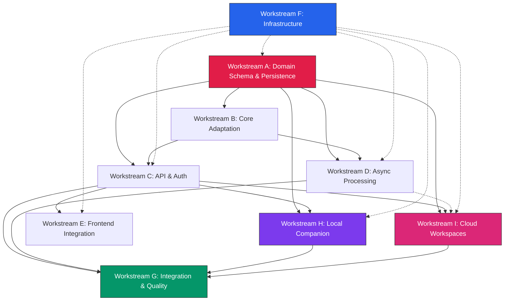

# Backend Implementation Plan — Deku / Pos-Deku

**Cross-references**: [ARCHITECTURE_DECISIONS.md](ARCHITECTURE_DECISIONS.md), [DATA_MODEL.md](DATA_MODEL.md), [API_CONTRACT.md](API_CONTRACT.md), [AWS_INFRASTRUCTURE.md](AWS_INFRASTRUCTURE.md), [COMPATIBILITY_FINDINGS.md](COMPATIBILITY_FINDINGS.md)

---

## 1. Workstream Overview

| ID | Workstream | Owner | Duration | Dependencies |
|----|------------|-------|----------|--------------|
| **A** | Domain Schema & Persistence | Backend Lead | 3 weeks | — |
| **B** | Existing Core Adaptation | Domain Engineer | 2 weeks | A (interfaces) |
| **C** | API & Authentication | API Engineer | 2 weeks | A (repos), B (services) |
| **D** | Asynchronous Processing | Backend Lead | 2 weeks | A (schema), B (extraction pipeline) |
| **E** | Frontend API Integration | Frontend Engineer | 2 weeks | C (contract), A (data shapes) |
| **F** | Infrastructure & Deployment | DevOps | 3 weeks (parallel) | — |
| **G** | Integration & Quality | QA/Backend Lead | Ongoing | All |
| **H** | Local Companion Protocol | Platform Engineer | 3 weeks | A (devices table), C (auth), F (session broker) |
| **I** | Cloud Workspace Provisioning | Platform Engineer | 3 weeks | A (workspace tables), C (workspaces API), F (IAM, EC2) |

---

## 2. Workstream Details

### Workstream A: Domain Schema & Persistence

**Scope**: Define all SQLAlchemy models (15 tables), Alembic migrations, repository interfaces + implementations, revision triggers, conflict resolution logic, SQLite/PostgreSQL compatibility.

**Exclusions**: Business logic, API handlers, worker code.

**Deliverables**:
- `src/personal_os/db/models/` — 15 ORM models matching DATA_MODEL.md (11 core + 4 hybrid)
- `src/personal_os/db/repositories/` — 10 repository interfaces + SQLAlchemy impls
- `src/personal_os/db/migrations/` — Alembic env + initial migration (0001)
- `src/personal_os/db/session.py` — Async session management, pool config
- `tests/db/test_models.py` — Model creation, constraints, triggers
- `tests/db/test_repositories.py` — CRUD, optimistic lock, conflict scenarios
- `tests/db/test_migrations.py` — Upgrade/downgrade on PG + SQLite

**Files Owned**: `src/personal_os/db/**`, `alembic/**`, `tests/db/**`

**Dependencies**: None (starts first)

**Parallelizable Tasks**:
- A1: Core ORM models (11 tables) + Alembic setup (1 week)
- A2: Hybrid ORM models (4 tables: devices, workspace_templates, workspace_instances, sessions) (0.5 week)
- A3: Repository interfaces + implementations (1 week)
- A4: Revision triggers + conflict resolution (0.5 week)
- A5: SQLite compatibility + migration tests (0.5 week)

**Integration Points**:
- Provides `AsyncSession` + repository instances to Workstreams B, C, D, H, I
- Schema must be stable before Workstream C writes contract tests

**Acceptance Criteria**:
1. `alembic upgrade head` succeeds on PostgreSQL 16 and SQLite
2. All 15 tables created with correct constraints, indexes, triggers
3. `revision` increments on UPDATE; stale `If-Match` returns 0 rows
4. `sync_metadata` idempotency key prevents duplicate application
5. Conflict detection returns server state for UI resolution
6. FTS search returns ranked results < 100ms on 10k rows
7. Export/import round-trips tasks, captures, project docs
8. Device registration + heartbeat works; stale detection functional
9. Workspace instance lifecycle enforced (pending → provisioning → running → terminated)

**Tests**:
```bash
uv run pytest tests/db/ -v
uv run pytest tests/db/test_migrations.py -v  # runs against PG + SQLite
```

---

### Workstream B: Existing Core Adaptation

**Scope**: Preserve `core/extraction/` pipeline; adapt `capture.py`, `processor.py`, `llm.py` to new persistence layer; fix correctness issues (F-004, F-005, F-006, F-007, F-008, F-010 from audit); remove `vault.py` dependency from core.

**Exclusions**: TUI code (`tui/**`), CLI enhancements, new features.

**Deliverables**:
- `src/personal_os/core/capture.py` — Adapted: `persist_capture()` → `CaptureRepository.create()`, returns `CaptureReceipt` with DB ID
- `src/personal_os/core/processor.py` — `BackgroundProcessor` becomes stateless message handler; `_process_entry()` uses `ProcessingService`; batch logic removed (DB transactions replace git batch)
- `src/personal_os/core/llm.py` — `get_provider(config.model)` fix (F-005)
- `src/personal_os/core/extraction/resolver.py` — `ProjectResolver` accepts aliases from config (F-008)
- `src/personal_os/services/processing.py` — NEW: `ProcessingService` orchestrates extraction pipeline + DB writes
- `src/personal_os/services/captures.py` — NEW: `CaptureService` handles persist-first + queue dispatch
- `tests/core/test_capture_contract.py` — Capture contract with DB
- `tests/core/test_processing_pipeline.py` — Full pipeline with mocked LLM

**Files Owned**: `src/personal_os/core/capture.py`, `src/personal_os/core/processor.py`, `src/personal_os/core/llm.py`, `src/personal_os/core/extraction/resolver.py`, `src/personal_os/services/processing.py`, `src/personal_os/services/captures.py`, `tests/core/**`

**Dependencies**: Workstream A (repository interfaces must exist)

**Parallelizable Tasks**:
- B1: Fix `get_provider` + `ProjectResolver` aliases (0.5 week) — independent
- B2: `CaptureService` + adapted `capture.py` (1 week)
- B3: `ProcessingService` + adapted `processor.py` (1 week)
- B4: Verify no legacy `vault.py` code remains in core

**Integration Points**:
- Consumes Workstream A repositories
- Provides `CaptureService`, `ProcessingService` to Workstream C & D
- Extraction pipeline (`core/extraction/**`) unchanged except resolver alias injection

**Acceptance Criteria**:
1. `persist_capture()` writes to `captures` table + dispatches to SQS (or local queue in tests)
2. `ProcessingService` runs full pipeline: LLM → Validator → Resolver (with aliases) → Planner → `extracted_items` + `tasks`/`projects` writes
3. Batch replaced by DB transaction: all vault writes in single transaction or none
4. `get_provider(config.model)` reads `provider`, `model_name`, `base_url` correctly
5. `ProjectResolver` resolves "maestro" → "Maestro" via injected aliases
6. All existing extraction pipeline tests pass (`test_semantic_pipeline.py` adapted)

**Tests**:
```bash
uv run pytest tests/core/ -v
uv run pytest tests/test_semantic_pipeline.py -v  # adapted to use DB repos
```

---

### Workstream C: API & Authentication

**Scope**: FastAPI app, Cognito JWT validation (user + device), all endpoint groups per API_CONTRACT.md (14 route modules), request/response schemas, error handling, contract tests.

**Exclusions**: Business logic (in services), worker, infrastructure.

**Deliverables**:
- `src/personal_os/api/main.py` — App factory, lifespan, middleware, routers
- `src/personal_os/api/deps.py` — Auth (user + device), DB session, service injection
- `src/personal_os/api/schemas/` — All Pydantic models from API_CONTRACT.md
- `src/personal_os/api/routes/` — 14 route modules (tasks, projects, captures, processing, focus, stats, files, search, export, devices, companion, workspaces, sync, sessions)
- `src/personal_os/api/exceptions.py` — RFC 7807 error handlers
- `tests/contract/` — Contract tests per API_CONTRACT.md §6

**Files Owned**: `src/personal_os/api/**`, `tests/contract/**`

**Dependencies**: Workstream A (repositories), Workstream B (services)

**Parallelizable Tasks** (after A+B interfaces stable):
- C1: FastAPI skeleton + dual auth (user + device) + error handling (0.5 week)
- C2: Tasks + Projects routes (0.5 week)
- C3: Captures + Processing routes (0.5 week)
- C4: Focus + Stats + Files + Search + Export routes (1 week)
- C5: Devices + Companion + Workspaces + Sync + Sessions routes (1 week)
- C6: Contract tests (parallel with route implementation)

**Integration Points**:
- Routes delegate to services from B, H, I
- Contract tests use test DB (Workstream A fixtures)
- OpenAPI schema generated for frontend (Workstream E)

**Acceptance Criteria**:
1. All 14 route groups implemented with correct schemas
2. Cognito JWT validated for user (`sub` → `user_id`) and device (`device_id`)
3. Optimistic locking via `If-Match` header returns 409 with server state
4. RFC 7807 errors for all failure modes
5. OpenAPI schema matches API_CONTRACT.md
6. All contract tests pass

**Tests**:
```bash
uv run pytest tests/contract/ -v
uv run python -c "from api.main import app; print(app.openapi())"  # verify schema
```

---

### Workstream D: Asynchronous Processing

**Scope**: SQS consumer workers (capture + workspace), idempotent processing, retry logic, DLQ handling, processing status updates.

**Exclusions**: Extraction pipeline logic (in B), API handlers (in C).

**Deliverables**:
- `src/personal_os/workers/capture_worker.py` — SQS consumer loop, message parsing, delegation to `ProcessingService`
- `src/personal_os/workers/workspace_worker.py` — **NEW**: Workspace provisioning consumer (EC2 RunInstances, template application, Git clone)
- `src/personal_os/workers/__main__.py` — Entry point, signal handling, graceful shutdown
- `src/personal_os/services/processing.py` — Extended with `process_capture_message()` for worker
- `tests/workers/test_capture_worker.py` — Idempotency, retry, DLQ, status transitions
- `tests/workers/test_workspace_worker.py` — **NEW**: Provisioning flow, template application, Git clone, cost limits

**Files Owned**: `src/personal_os/workers/**`, `tests/workers/**`

**Dependencies**: Workstream A (schema, `processing_jobs` + `workspace_instances` tables), Workstream B (`ProcessingService`), Workstream I (`WorkspaceService`)

**Parallelizable Tasks**:
- D1: Capture worker skeleton + SQS config (0.5 week) — can start after A schema stable
- D2: Workspace worker skeleton + EC2 provisioning (1 week)
- D3: Idempotent message handling + status updates (1 week)
- D4: Retry + DLQ + visibility timeout tuning (0.5 week)

**Integration Points**:
- Consumes `ProcessingService` from B, `WorkspaceService` from I
- Updates `processing_jobs` + `captures` + `workspace_instances` tables (Workstream A repos)
- SQS queues created by Workstream F (infrastructure)

**Acceptance Criteria**:
1. Capture worker polls SQS FIFO, processes messages, updates `processing_jobs.status`
2. Workspace worker polls SQS Standard, provisions EC2, applies template, returns connection info
3. Idempotency key prevents duplicate processing on redelivery
4. Failed messages retry up to 3x with exponential backoff; then DLQ
5. `Capture.processing_status` + `WorkspaceInstance.status` reflect job state
6. Graceful shutdown on SIGTERM (finish current message, don't ack next)
7. Local dev works with in-memory queue (no SQS required)

**Tests**:
```bash
uv run pytest tests/workers/ -v
# Integration: deploy to dev, send test message via AWS CLI
```

---

### Workstream E: Frontend API Integration

**Scope**: Replace mock data in `ui/src/lib/blockday-data.ts` and `ui/src/lib/blockday-store.tsx` with API calls; define typed API client; implement offline queue + sync; identify minimal UI changes for 6 pages.

**Exclusions**: UI redesign, new components, design system changes.

**Deliverables**:
- `ui/src/lib/api-client.ts` — Typed fetch wrapper with auth, error handling, optimistic updates
- `ui/src/lib/blockday-api.ts` — Domain-specific API functions (all 14 endpoint groups)
- `ui/src/lib/blockday-store-api.tsx` — New store implementation using API (replaces localStorage)
- `ui/src/lib/offline-queue.ts` — **NEW**: IndexedDB offline queue + reconciliation logic
- Migration plan for each of 6 pages: Today, Flow, Projects, Focus, Stats, Diary

**Files Owned**: `ui/src/lib/api-client.ts`, `ui/src/lib/blockday-api.ts`, `ui/src/lib/blockday-store-api.tsx`, `ui/src/lib/offline-queue.ts`

**Dependencies**: Workstream C (API contract stable, OpenAPI schema)

**Parallelizable Tasks** (after C OpenAPI stable):
- E1: API client + auth integration + optimistic updates (0.5 week)
- E2: Tasks + Projects API bindings (0.5 week)
- E3: Captures/Diary + Focus + Stats API bindings (0.5 week)
- E4: Sync endpoints + offline queue + reconciliation (1 week)
- E5: Store migration + page-by-page swap (1 week)

**Integration Points**:
- Consumes API from C
- Uses Cognito auth from frontend (Amplify or custom)
- Mock adapter for development until API deployed

**Acceptance Criteria**:
1. All 6 pages load data from API (no localStorage for canonical data)
2. Mutations (create task, complete task, add capture) hit API and update UI
3. Optimistic UI updates with rollback on 409
4. Offline queue stores operations in IndexedDB; sync on reconnect via `/sync/operations`
5. Conflicts surfaced in UI via `/sync/status` + `/sync/conflicts/{id}/resolve`
6. No TypeScript errors; builds pass

**Tests**:
```bash
cd ui && npm test  # Vitest/RTL tests
npm run build      # TypeScript compile
```

---

### Workstream F: Infrastructure & Deployment

**Scope**: Terraform for all AWS resources, CI/CD pipeline, deployment scripts, health checks, CloudWatch dashboards/alarms.

**Exclusions**: Application code, database migrations (handled by app).

**Deliverables**:
- `terraform/aws/` — Complete infra (VPC, RDS, S3, SQS, Cognito, CloudFront, ACM, IAM, CloudWatch, **NEW: workspace IAM roles, session broker SG**)
- `.github/workflows/` — Build, test, deploy workflows (including companion build)
- `scripts/deploy.sh` — SSM-based deploy script (multi-role)
- `docs/DEPLOYMENT.md` — Runbook
- `companion/` — **NEW**: Companion daemon package (separate PyPI-style package)

**Files Owned**: `terraform/**`, `.github/workflows/**`, `scripts/**`, `docs/DEPLOYMENT.md`, `companion/**`

**Dependencies**: None (parallel with A-E, H, I)

**Parallelizable Tasks**:
- F1: VPC + RDS + S3 + SQS (1 week)
- F2: Cognito + CloudFront + ACM (0.5 week)
- F3: IAM roles (EC2 + Workspace Instance) + CloudWatch + Alarms (1 week)
- F4: CI/CD pipeline + deploy scripts (0.5 week)
- F5: Companion package structure + build pipeline (0.5 week)

**Integration Points**:
- Provides endpoints/secrets to Workstream C (config)
- SQS queue URLs → worker config (Workstream D)
- Database URL → app config (Workstream A/B/C/H/I)
- Session broker SG + WebSocket endpoint → Workstream H
- Workspace IAM role + EC2 permissions → Workstream I

**Acceptance Criteria**:
1. `terraform apply` succeeds for `dev`/`prod` workspaces
2. EC2 instances join ASG, register with ALB, pass health checks (8000, 8001)
3. RDS accessible; migrations run
4. SQS queues receive/process messages (capture, export, workspace)
5. Cognito issues user JWT + device JWT; API validates both
6. S3 presigned URLs work (CORS OK); template bucket accessible
7. CloudFront serves frontend + proxies API + WebSocket; TLS valid
8. Secrets retrieved at runtime; no secrets in artifacts
9. CloudWatch alarms fire on simulated failures
10. Deploy script updates code + migrations + restarts < 2 min
11. Companion package builds and installs
12. Session broker accepts WebSocket, validates JWT, forwards RPC
13. Workspace worker provisions instance, applies template, returns WS URL
14. Workspace instance accessible via portal terminal; Git handoff works

**Tests**:
```bash
cd terraform && terraform plan -var-file=dev.tfvars
cd terraform && terraform apply -var-file=dev.tfvars -auto-approve
./scripts/smoke-test.sh dev  # health, ready, auth, db, sqs, ws, workspace
```

---

### Workstream G: Integration & Quality

**Scope**: Cross-workstream integration testing, end-to-end flows, performance baselines, deployment smoke tests, quality gates.

**Exclusions**: Unit/contract tests (owned by respective workstreams).

**Deliverables**:
- `tests/integration/` — E2E tests: capture → processing → task creation → UI; offline→online sync; companion terminal; workspace provision→terminal→handoff
- `tests/performance/` — Locust/k6 scripts for API load
- `scripts/integration-test.sh` — Full stack test against dev
- Quality gate definitions (PR checks, deploy gates)

**Files Owned**: `tests/integration/**`, `tests/performance/**`, `scripts/integration-test.sh`, `.github/workflows/integration.yml`

**Dependencies**: All workstreams (runs after each integration milestone)

**Parallelizable Tasks**:
- G1: E2E test framework + capture→task flow (1 week)
- G2: Sync/conflict test scenarios (0.5 week)
- G3: Companion terminal test scenarios (0.5 week)
- G4: Workspace provision→terminal→handoff test (0.5 week)
- G5: Load test + baseline (0.5 week)
- G6: Deploy gate automation (0.5 week)

**Acceptance Criteria**:
1. E2E: Voice capture → API → processing → task appears in Today page
2. Sync: Offline edit + concurrent server edit → conflict surfaced in UI
3. Companion: Terminal session → RPC call → result returned
4. Workspace: Provision → template applied → terminal accessible → Git handoff on terminate
5. Load: 100 RPS sustained, p95 < 200ms, 0 errors
6. Deploy: `main` branch auto-deploys to dev; staging/prod manual approval

---

### Workstream H: Local Companion Protocol

**Scope**: Local daemon (`pos-companion`), device registration, heartbeat, authenticated outbound connection, approved RPC interface, session broker WebSocket client.

**Exclusions**: Full TUI/CLI rewrite, arbitrary command execution, unrestricted shell.

**Deliverables**:
- `companion/daemon.py` — Main daemon loop, WebSocket connection manager
- `companion/auth.py` — Device credential management (Cognito device JWT)
- `companion/discovery.py` — Local project discovery (scans known paths, reads Git remotes)
- No local companion database or queue; sync uses the authenticated cloud protocol when connected
- `companion/rpc/` — Approved RPC methods:
  - `terminal`: `pty_spawn`, `pty_write`, `pty_read`, `pty_resize`, `pty_kill`, `pty_list`
  - `filesystem`: `fs_read`, `fs_list`, `fs_stat`, `fs_write`, `fs_mkdir` (path allowlist)
  - `process`: `ps_list`, `ps_exec` (allowlist + approval)
  - `agent`: `agent_spawn`, `agent_status` (Hermes-specific)
- `companion/manifest.py` — RPC manifest served to portal
- `tests/companion/` — Unit + integration tests (mock session broker)

**Files Owned**: `companion/**` (separate package), `tests/companion/**`

**Dependencies**: Workstream A (`devices` table, `sync_metadata`), Workstream C (device auth, companion routes), Workstream F (session broker on EC2, WebSocket endpoint)

**Parallelizable Tasks** (after A device schema + C device routes stable):
- H1: Device registration + Cognito device JWT + heartbeat (1 week)
- H2: WebSocket client + session broker connection + reconnection logic (1 week)
- H3: Authenticated sync protocol client after the M1 contract and M2 credentials are stable (later milestone)
- H4: RPC framework + approved methods + capability checks (1 week)
- H5: Project discovery + manifest generation (0.5 week)

**Integration Points**:
- Registers with `/api/v1/devices` + Cognito device tracking
- Connects to `/ws/companion` with session token
- Receives RPC calls from portal via session broker
- Submits operations only through the verified authenticated cloud sync protocol; no durable disconnected queue is implemented

**Acceptance Criteria**:
1. Daemon registers device, obtains device JWT, reports online/offline via heartbeat
2. WebSocket connects to session broker, authenticates with session token
3. Portal can request capabilities → session created → WebSocket established
4. Approved RPC methods execute and return results (terminal, fs, process, agent)
5. Path allowlist enforced for filesystem ops; command allowlist for process exec
6. No disconnected companion edits are accepted as durably queued; a future PostgreSQL-compatible edge outbox requires a separate design decision
6. All RPC calls logged to `session_audit` with redacted params
7. Device revocation immediately terminates sessions

**Tests**:
```bash
uv run pytest tests/companion/ -v
# Integration: run daemon locally against dev session broker
```

---

### Workstream I: Cloud Workspace Provisioning

**Scope**: Workspace templates (devcontainer/Nix/script), provisioning worker, instance lifecycle, Git handoff, cost controls.

**Exclusions**: Full IDE integration, custom agent orchestration beyond Hermes.

**Deliverables**:
- `src/personal_os/services/workspaces.py` — `WorkspaceService` (provision, lifecycle, cost tracking)
- `src/personal_os/workers/workspace_worker.py` — SQS consumer → EC2 RunInstances → template apply
- `companion/templates/` — **Reference templates**: devcontainer.json, flake.nix, setup.sh
- `terraform/aws/workspace.tf` — **NEW**: IAM roles, instance profiles, security groups
- `tests/workspaces/` — Provisioning flow, template application, Git clone, handoff

**Files Owned**: `src/personal_os/services/workspaces.py`, `src/personal_os/workers/workspace_worker.py`, `terraform/aws/workspace.tf`, `tests/workspaces/**`

**Dependencies**: Workstream A (workspace tables), Workstream C (workspaces API), Workstream F (IAM roles, EC2 permissions, S3 templates bucket)

**Parallelizable Tasks** (after A workspace schema + C workspaces API stable):
- I1: Template specification + S3 layout + reference templates (0.5 week)
- I2: WorkspaceService + provisioning API (1 week)
- I3: Workspace worker + EC2 provisioning + UserData template application (1.5 weeks)
- I4: Git clone + branch handoff + cost tracking + idle shutdown (1 week)
- I5: Cost limits + concurrent workspace quota + termination cleanup (0.5 week)

**Integration Points**:
- API routes in C delegate to `WorkspaceService`
- SQS message → WorkspaceWorker provisions EC2
- Instance UserData: clones GitHub repo (GitHub App token), applies template, starts tools
- Session broker provides WebSocket terminal (`/ws/workspace/{instance_id}`)
- On terminate: Git status → push uncommitted to `workspace/<id>/<ts>` branch

**Acceptance Criteria**:
1. Portal requests workspace → SQS message → worker provisions EC2 (t3.medium default)
2. Instance UserData applies devcontainer/Nix/script template from S3
3. GitHub repo cloned (GitHub App token); correct branch checked out
4. VS Code Server / tmux / Hermes started; terminal accessible via portal WebSocket
5. Cost tracking updates `accumulated_cost_usd`; auto-terminate on limit
6. Idle timeout → auto-terminate; max runtime enforced
7. On terminate: uncommitted changes → pushed to recovery branch; user notified
8. Max 2 concurrent workspaces per user; quota enforced

**Tests**:
```bash
uv run pytest tests/workspaces/ -v
# Integration: request workspace in dev, verify provisioning → terminal → terminate
```

---

## 3. Dependency Graph (Mermaid)



---

## 4. Critical Path

```
A (3 weeks) → B (2 weeks) → C (2 weeks) → E (2 weeks) → G (1 week)
                    ↘              ↘
                     D (2 weeks)    H (3 weeks) → G
                                    I (3 weeks) → G
```

**Critical Path Duration**: ~12 weeks (A→B→C→E→G) with H/I parallel after C

**Non-Critical / Parallel**:
- F (Infrastructure): 3 weeks, starts Day 1, must complete before C/D/H/I integration
- D can start after A schema stable (week 3), runs parallel with C
- H starts after A device schema + C device routes (week 5), runs parallel with E
- I starts after A workspace schema + C workspaces API (week 5), runs parallel with E/H
- G runs continuously after first integration milestone

---

## 5. File Ownership Strategy (Parallel Safety)

| File/Module | Owner Workstream | Notes |
|-------------|------------------|-------|
| `src/personal_os/db/**` | A | Exclusive |
| `src/personal_os/core/capture.py` | B | Exclusive |
| `src/personal_os/core/processor.py` | B | Exclusive |
| `src/personal_os/core/extraction/**` | B (read-only after alias fix) | B modifies `resolver.py` only |
| `src/personal_os/services/**` | B (core), H (devices), I (workspaces) | Per-domain |
| `src/personal_os/api/**` | C | Exclusive |
| `src/personal_os/workers/**` | D | Exclusive |
| `ui/src/lib/**` | E | Exclusive |
| `terraform/**` | F | Exclusive |
| `companion/**` | H | Exclusive |
| `tests/db/**` | A | Exclusive |
| `tests/core/**` | B | Exclusive |
| `tests/contract/**` | C | Exclusive |
| `tests/workers/**` | D | Exclusive |
| `tests/companion/**` | H | Exclusive |
| `tests/workspaces/**` | I | Exclusive |
| `tests/integration/**` | G | Exclusive |

**Coordination Protocol**:
1. Workstream A publishes repository interfaces (`db/repositories/interfaces.py`) by end of Week 1
2. Workstreams B, C, D, H, I develop against interfaces using **mocks/stubs** until A delivers implementations
3. Weekly sync (30 min) to verify interface compliance
4. PRs target `main` with short-lived feature branches; squash merge
5. No direct edits to another workstream's files — open PR or request

---

## 6. Milestones & Gates (Revised: M1-M5)

| Milestone | Target Week | Gate Criteria | Go/No-Go |
|-----------|-------------|---------------|----------|
| **M1: Cloud-Backed Portal** | 5 | A1-A5 complete; B1-B4 complete; C1-C6 complete; D1-D2 complete; all contract tests pass; OpenAPI schema matches spec; dev infra deployed | A,B,C,D → E,H,I |
| **M2: Local Integration** | 8 | H1-H5 complete; companion registers, heartbeats, WebSocket connects; device auth works; session broker forwards RPC | H → G (sync) |
| **M3: Synchronization** | 10 | Sync endpoints complete; offline queue + reconciliation tested; conflict UI works; E1-E5 complete (frontend connected) | E,H → G |
| **M4: Remote Laptop Access** | 12 | Companion RPC (terminal, fs, process, agent) works; capability checks enforced; session audit logged; session revocation immediate | H → G |
| **M5: On-Demand Cloud Development** | 15 | I1-I5 complete; workspace provisions → template applied → terminal → Git handoff; cost limits enforced; quota works | I → **Release Candidate** |

---

## 7. First Implementation Milestone (M1: Cloud-Backed Portal)

**Target**: End of Week 5

**Scope**: Workstreams A, B, C, D complete (core portal)

**Acceptance Criteria**:
1. `alembic upgrade head` creates all 15 tables on PostgreSQL 16 and SQLite
2. Revision trigger fires on UPDATE; `If-Match` returns 409 with server state
3. `sync_metadata` idempotency key prevents duplicate application
4. Conflict detection function returns server state for UI resolution
5. FTS search returns ranked results < 100ms on 10k seeded rows
6. Export produces valid markdown matching existing vault structure
7. Import round-trips tasks, captures, project docs without data loss
8. Device registration + heartbeat works; stale detection functional
9. Workspace instance lifecycle enforced (pending → provisioning → running → terminated)
10. Capture worker processes SQS messages; idempotency verified
11. All contract tests pass (14 route groups)
12. OpenAPI schema matches API_CONTRACT.md

**Commands to Verify**:
```bash
# PostgreSQL
uv run alembic upgrade head
uv run pytest tests/db/ -v
uv run pytest tests/contract/ -v
uv run pytest tests/workers/ -v

# SQLite (CI)
SQLALCHEMY_DATABASE_URL=sqlite:///test.db uv run alembic upgrade head
SQLALCHEMY_DATABASE_URL=sqlite:///test.db uv run pytest tests/db/ -v

# Migration round-trip
uv run alembic downgrade base
uv run alembic upgrade head
```

**Risks & Fallbacks**:
- Risk: Alembic + SQLite compatibility issues → Fallback: Use `sqlalchemy.dialects.sqlite` with `json1` pragma; test early
- Risk: Revision trigger performance → Fallback: Optimize with `WHERE revision = $3` index hint
- Risk: FTS5 not available on managed SQLite → Fallback: Use Tantivy for SQLite, PostgreSQL FTS for PG
- Risk: Companion device auth complexity → Fallback: Start with API key auth, migrate to Cognito device tracking

---

## 8. Approval Required

The following decisions require explicit approval before implementation begins:

### Infrastructure & Compute
1. **OD-001**: EC2 vs ECS/Fargate for API + workers (locked as EC2)
2. **OD-002**: RDS instance sizing (`db.t3.micro` dev / `db.t3.small` prod)
3. **OD-003**: SQS FIFO for capture processing (vs Standard + app dedup)
4. **OD-004**: Cognito Hosted UI vs Custom auth pages

### Sync & Conflict
5. **OD-005**: Export format — zip download (vs streaming)
6. **OD-006**: Conflict resolution default — LWW with safeguards (safe ops list)
7. **OD-007**: Offline sync scope v1 — cloud canonical, queue on reconnect (vs background sync)
8. **OD-010**: Migration policy — additive-only for v1

### Frontend & Data
9. **OD-011**: Search backend — PostgreSQL FTS only (vs Tantivy)
10. **OD-012**: Timezone handling — client sends IANA tz + user profile default
11. **OD-016**: Frontend data shape mapping — `dueIn` computed from `deadline`; `start_minute` ↔ `start`

### Remote Access & Companion
12. **OD-008**: TUI/CLI strategy — deprecate TUI; CLI via API (thin client) for v1
13. **OD-013**: Voice capture — defer to post-v1
14. **OD-014**: S3 CORS domain — confirm `app.pos-deku.com`
15. **OD-015**: Alarm thresholds — deploy estimates, tune after baseline

### Remote Access Security
16. **OD-017**: Companion RPC capabilities — approve initial set (terminal, fs, process, agent)
17. **OD-018**: Session token TTL — 15 min default, renewable
18. **OD-019**: mTLS vs JWT for companion → broker — JWT (simpler, Cognito device tracking)

### Cloud Workspaces
19. **OD-020**: Template format — devcontainer.json primary, Nix flake + script fallback
20. **OD-021**: GitHub auth — GitHub App (preferred) vs PAT
21. **OD-022**: Max concurrent workspaces — 2 per user
22. **OD-023**: Idle timeout — 30 min default
23. **OD-024**: Max runtime — 4 hours default

### Cost & Operations
24. **OD-025**: Spot instances for workspace worker — yes
25. **OD-026**: Cost limit default — $5/workspace
26. **OD-027**: Recovery branch naming — `workspace/<id>/<timestamp>`

---

## 9. Summary

| Aspect | Verdict |
|--------|---------|
| **Architecture Compatible?** | **Yes** — Core extraction pipeline reusable; VaultManager → SQLAlchemy; persist-first → DB + SQS; hybrid local+AWS adds companion + workspaces as new domains |
| **Necessary Changes** | 1. Replace `VaultManager` with SQLAlchemy (A) 2. Adapt core to services + SQS (B) 3. Fix `get_provider` + aliases (B1) 4. Build FastAPI + dual auth (C) 5. Build SQS workers (capture + workspace) (D) 6. Build companion daemon + session broker (H) 7. Build workspace provisioning (I) 8. Provision AWS infra (F) |
| **Implementation Order** | A → (B + F) → (C + D) → (E + H + I) → G |
| **Parallel Workstreams** | A starts alone; F starts Day 1; B/C/D parallel after M1; E/H/I parallel after M2; G continuous |
| **Critical Path** | A (3w) → B (2w) → C (2w) → E (2w) → G (1w) = ~10 weeks; H/I add ~3w parallel after C |
| **First Milestone** | M1: Cloud-Backed Portal (Week 5) — core portal + device/workspace schema |
| **Blocking Decisions** | 27 items in §8 — need approval before Week 1 |

---

**Stop after producing the revised documents. Do not begin implementation until the plan has been reviewed and approved.**
