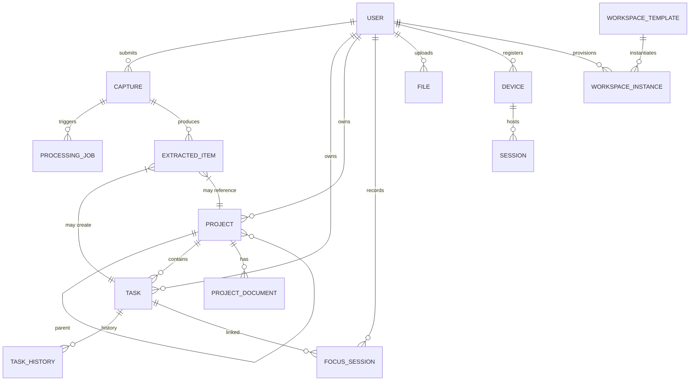

# Data Model — Deku / Pos-Deku Backend

**Cross-references**: [ARCHITECTURE_DECISIONS.md](ARCHITECTURE_DECISIONS.md) (deployment, conflict rules), [API_CONTRACT.md](API_CONTRACT.md) (schemas), [BACKEND_IMPLEMENTATION_PLAN.md](BACKEND_IMPLEMENTATION_PLAN.md) (workstream A)

---

## 1. Entity Overview



---

## 2. Core Tables (PostgreSQL)

### 2.1 `users` (Synced from Cognito)

| Column | Type | Constraints | Notes |
|--------|------|-------------|-------|
| `id` | `uuid` | PK | Cognito `sub` |
| `email` | `text` | NOT NULL, UNIQUE | |
| `display_name` | `text` | | |
| `preferred_timezone` | `text` | DEFAULT 'UTC' | IANA timezone for deadline normalization |
| `created_at` | `timestamptz` | NOT NULL DEFAULT now() | |
| `updated_at` | `timestamptz` | NOT NULL DEFAULT now() | Trigger-maintained |

### 2.2 `projects`

| Column | Type | Constraints | Notes |
|--------|------|-------------|-------|
| `id` | `uuid` | PK | ULID stored as uuid |
| `user_id` | `uuid` | FK → users.id, NOT NULL | |
| `parent_id` | `uuid` | FK → projects.id, NULLABLE | Nesting |
| `name` | `text` | NOT NULL | |
| `summary` | `text` | | |
| `tone` | `text` | NOT NULL DEFAULT 'neutral' | red\|blue\|yellow\|neutral |
| `progress` | `integer` | NOT NULL DEFAULT 0 CHECK (0-100) | Derived from tasks |
| `active` | `boolean` | NOT NULL DEFAULT true | Featured on Today/Flow |
| `revision` | `integer` | NOT NULL DEFAULT 1 | Optimistic locking |
| `created_at` | `timestamptz` | NOT NULL DEFAULT now() | |
| `updated_at` | `timestamptz` | NOT NULL DEFAULT now() | Trigger |
| `deleted_at` | `timestamptz` | NULLABLE | Soft delete |

**Indexes**: `(user_id, parent_id)`, `(user_id, active)`

### 2.3 `tasks`

| Column | Type | Constraints | Notes |
|--------|------|-------------|-------|
| `id` | `uuid` | PK | |
| `user_id` | `uuid` | FK → users.id, NOT NULL | |
| `project_id` | `uuid` | FK → projects.id, NOT NULL | Inbox = special project |
| `title` | `text` | NOT NULL | |
| `estimate` | `integer` | NOT NULL DEFAULT 15 | Minutes |
| `mood` | `text` | NOT NULL DEFAULT 'Clear' | Deep\|Clear\|Creative\|Easy |
| `frog` | `boolean` | NOT NULL DEFAULT false | Eat-the-frog marker |
| `due_in` | `integer` | NULLABLE | Days from viewed day; negative = overdue |
| `start_minute` | `integer` | NULLABLE | Minutes from 06:00 for Flow scheduling |
| `done` | `boolean` | NOT NULL DEFAULT false | |
| `completed_at` | `timestamptz` | NULLABLE | Set when done=true |
| `archived_at` | `timestamptz` | NULLABLE | Moved to completed archive |
| `revision` | `integer` | NOT NULL DEFAULT 1 | Optimistic locking |
| `created_at` | `timestamptz` | NOT NULL DEFAULT now() | |
| `updated_at` | `timestamptz` | NOT NULL DEFAULT now() | Trigger |
| `deleted_at` | `timestamptz` | NULLABLE | Soft delete |

**Indexes**: `(user_id, project_id, done)`, `(user_id, due_in)`, `(user_id, completed_at)`

### 2.4 `captures` (Diary / Raw Captures)

| Column | Type | Constraints | Notes |
|--------|------|-------------|-------|
| `id` | `uuid` | PK | ULID from capture contract |
| `user_id` | `uuid` | FK → users.id, NOT NULL | |
| `raw_text` | `text` | NOT NULL | Original capture, immutable |
| `source` | `text` | NOT NULL DEFAULT 'Text' | Text\|Voice\|CLI\|API |
| `timestamp` | `timestamptz` | NOT NULL | When captured |
| `timezone` | `text` | NULLABLE | IANA timezone for deadline normalization |
| `processing_status` | `text` | NOT NULL DEFAULT 'pending' | pending\|queued\|running\|succeeded\|failed |
| `processing_job_id` | `uuid` | FK → processing_jobs.id, NULLABLE | Link to async job |
| `extraction_error` | `text` | NULLABLE | If processing failed |
| `created_at` | `timestamptz` | NOT NULL DEFAULT now() | |
| `updated_at` | `timestamptz` | NOT NULL DEFAULT now() | Trigger |

**Indexes**: `(user_id, timestamp DESC)`, `(user_id, processing_status)`

### 2.5 `processing_jobs`

| Column | Type | Constraints | Notes |
|--------|------|-------------|-------|
| `id` | `uuid` | PK | |
| `capture_id` | `uuid` | FK → captures.id, NOT NULL, UNIQUE | 1:1 with capture |
| `idempotency_key` | `uuid` | NOT NULL, UNIQUE | ULID for deduplication |
| `status` | `text` | NOT NULL DEFAULT 'queued' | queued\|running\|succeeded\|failed |
| `attempt` | `integer` | NOT NULL DEFAULT 0 | Retry count |
| `last_error` | `text` | NULLABLE | Last failure reason |
| `started_at` | `timestamptz` | NULLABLE | |
| `completed_at` | `timestamptz` | NULLABLE | |
| `created_at` | `timestamptz` | NOT NULL DEFAULT now() | |
| `updated_at` | `timestamptz` | NOT NULL DEFAULT now() | Trigger |

**Indexes**: `(status, created_at)`, `(capture_id)`

### 2.6 `extracted_items` (Semantic Layer)

| Column | Type | Constraints | Notes |
|--------|------|-------------|-------|
| `id` | `uuid` | PK | |
| `capture_id` | `uuid` | FK → captures.id, NOT NULL | |
| `extraction_type` | `text` | NOT NULL | task\|possible_task\|progress\|activity\|decision\|completion\|learning\|problem\|observation |
| `description` | `text` | NOT NULL | Actionable description |
| `project_id` | `uuid` | FK → projects.id, NULLABLE | Resolved project |
| `project_resolution` | `text` | NOT NULL | existing\|alias\|fuzzy\|new\|ambiguous\|unknown |
| `deadline` | `date` | NULLABLE | Normalized ISO date |
| `deadline_resolution` | `text` | NOT NULL | resolved\|deferred\|none |
| `deadline_raw` | `text` | NULLABLE | Original text for audit |
| `certainty` | `numeric(3,2)` | NOT NULL | User commitment 0.00-1.00 |
| `confidence` | `numeric(3,2)` | NOT NULL | Model confidence 0.00-1.00 |
| `source_excerpt` | `text` | NULLABLE | Traceability to original words |
| `temporal_context` | `text` | NULLABLE | Literal temporal expression |
| `action_type` | `text` | NOT NULL | CreateTask\|CreatePossibleTask\|RecordProgress\|RecordActivity\|AddDecision\|MarkComplete\|AppendLearning\|RecordProblem\|AppendNote\|NoOp |
| `action_payload` | `jsonb` | NOT NULL | Serialized VaultAction fields |
| `created_at` | `timestamptz` | NOT NULL DEFAULT now() | |

**Indexes**: `(capture_id)`, `(project_id)`

### 2.7 `focus_sessions`

| Column | Type | Constraints | Notes |
|--------|------|-------------|-------|
| `id` | `uuid` | PK | |
| `user_id` | `uuid` | FK → users.id, NOT NULL | |
| `task_id` | `uuid` | FK → tasks.id, NULLABLE | Linked task |
| `mode` | `text` | NOT NULL | Focus\|Break |
| `duration_seconds` | `integer` | NOT NULL | Actual elapsed |
| `planned_seconds` | `integer` | NOT NULL | 25*60 or 5*60 |
| `completed` | `boolean` | NOT NULL DEFAULT false | True if ran to completion |
| `started_at` | `timestamptz` | NOT NULL | |
| `ended_at` | `timestamptz` | NULLABLE | |
| `date` | `date` | NOT NULL | Day bucket for aggregates |
| `revision` | `integer` | NOT NULL DEFAULT 1 | |
| `created_at` | `timestamptz` | NOT NULL DEFAULT now() | |

**Indexes**: `(user_id, date)`, `(user_id, task_id)`

### 2.8 `project_documents` (Markdown Content)

| Column | Type | Constraints | Notes |
|--------|------|-------------|-------|
| `id` | `uuid` | PK | |
| `project_id` | `uuid` | FK → projects.id, NOT NULL | |
| `kind` | `text` | NOT NULL | readme\|progress\|tasks\|notes\|architecture\|decisions\|research\|timeline |
| `content` | `text` | NOT NULL | Markdown |
| `revision` | `integer` | NOT NULL DEFAULT 1 | |
| `created_at` | `timestamptz` | NOT NULL DEFAULT now() | |
| `updated_at` | `timestamptz` | NOT NULL DEFAULT now() | Trigger |

**Indexes**: `(project_id, kind)` UNIQUE

### 2.9 `files` (S3 Metadata)

| Column | Type | Constraints | Notes |
|--------|------|-------------|-------|
| `id` | `uuid` | PK | |
| `user_id` | `uuid` | FK → users.id, NOT NULL | |
| `project_id` | `uuid` | FK → projects.id, NULLABLE | Optional project context |
| `s3_key` | `text` | NOT NULL | Full object key |
| `bucket` | `text` | NOT NULL | S3 bucket name |
| `content_type` | `text` | NOT NULL | MIME type |
| `size_bytes` | `bigint` | NOT NULL | |
| `original_filename` | `text` | NOT NULL | |
| `purpose` | `text` | NOT NULL | upload\|draft\|generated\|export |
| `created_at` | `timestamptz` | NOT NULL DEFAULT now() | |

**Indexes**: `(user_id, project_id)`, `(s3_key)` UNIQUE

### 2.10 `sync_metadata` (Offline Reconciliation)

| Column | Type | Constraints | Notes |
|--------|------|-------------|-------|
| `id` | `uuid` | PK | |
| `user_id` | `uuid` | FK → users.id, NOT NULL | |
| `device_id` | `text` | NOT NULL | Client-generated stable ID |
| `operation_id` | `uuid` | NOT NULL, UNIQUE | ULID per operation |
| `entity_type` | `text` | NOT NULL | task\|project\|capture\|focus_session\|project_document |
| `entity_id` | `uuid` | NOT NULL | |
| `operation` | `text` | NOT NULL | create\|update\|delete\|complete |
| `base_revision` | `integer` | NOT NULL | Client's known revision |
| `client_updated_at` | `timestamptz` | NOT NULL | Client clock |
| `payload` | `jsonb` | NOT NULL | Operation data |
| `status` | `text` | NOT NULL DEFAULT 'pending' | pending\|applied\|conflict\|rejected |
| `conflict_data` | `jsonb` | NULLABLE | Server state if conflict |
| `created_at` | `timestamptz` | NOT NULL DEFAULT now() | |
| `resolved_at` | `timestamptz` | NULLABLE | |

**Indexes**: `(user_id, device_id, created_at)`, `(operation_id)` UNIQUE

### 2.11 `task_history` (Completion Audit)

| Column | Type | Constraints | Notes |
|--------|------|-------------|-------|
| `id` | `uuid` | PK | |
| `task_id` | `uuid` | FK → tasks.id, NOT NULL | |
| `user_id` | `uuid` | FK → users.id, NOT NULL | |
| `field` | `text` | NOT NULL | title\|estimate\|mood\|due_in\|done\|project_id |
| `old_value` | `jsonb` | NULLABLE | |
| `new_value` | `jsonb` | NOT NULL | |
| `changed_at` | `timestamptz` | NOT NULL DEFAULT now() | |

**Indexes**: `(task_id, changed_at DESC)`

---

## 3. New Tables for Hybrid Architecture

### 3.1 `devices` (Local Companion Registry)

| Column | Type | Constraints | Notes |
|--------|------|-------------|-------|
| `id` | `uuid` | PK | |
| `user_id` | `uuid` | FK → users.id, NOT NULL | |
| `device_id` | `text` | NOT NULL, UNIQUE | Stable client-generated ID |
| `name` | `text` | NOT NULL | Human-readable (e.g., "MacBook Pro") |
| `platform` | `text` | NOT NULL | linux\|darwin\|windows |
| `capabilities` | `jsonb` | NOT NULL DEFAULT '{}' | `{"terminal": true, "filesystem": true, "agent": true}` |
| `status` | `text` | NOT NULL DEFAULT 'offline' | online\|offline\|stale |
| `last_seen_at` | `timestamptz` | NULLABLE | Heartbeat timestamp |
| `registered_at` | `timestamptz` | NOT NULL DEFAULT now() | |
| `revoked_at` | `timestamptz` | NULLABLE | Soft revoke |
| `public_key` | `text` | NULLABLE | For mTLS / JWT verification |

**Indexes**: `(user_id, status)`, `(device_id)` UNIQUE

### 3.2 `workspace_templates` (Cloud Workspace Definitions)

| Column | Type | Constraints | Notes |
|--------|------|-------------|-------|
| `id` | `uuid` | PK | |
| `user_id` | `uuid` | FK → users.id, NOT NULL | |
| `name` | `text` | NOT NULL | e.g., "VLSI Devcontainer" |
| `description` | `text` | | |
| `template_type` | `text` | NOT NULL | devcontainer\|nix\|script |
| `s3_prefix` | `text` | NOT NULL | S3 path to template files |
| `default_instance_type` | `text` | DEFAULT 't3.medium' | |
| `max_runtime_minutes` | `integer` | DEFAULT 240 | |
| `idle_timeout_minutes` | `integer` | DEFAULT 30 | |
| `created_at` | `timestamptz` | NOT NULL DEFAULT now() | |
| `updated_at` | `timestamptz` | NOT NULL DEFAULT now() | Trigger |

### 3.3 `workspace_instances` (Provisioned Cloud Workspaces)

| Column | Type | Constraints | Notes |
|--------|------|-------------|-------|
| `id` | `uuid` | PK | |
| `user_id` | `uuid` | FK → users.id, NOT NULL | |
| `template_id` | `uuid` | FK → workspace_templates.id, NOT NULL | |
| `project_id` | `uuid` | FK → projects.id, NULLABLE | Associated project |
| `github_repo` | `text` | NOT NULL | e.g., "owner/repo" |
| `github_branch` | `text` | DEFAULT 'main' | |
| `ec2_instance_id` | `text` | NULLABLE | AWS instance ID |
| `ec2_instance_type` | `text` | NOT NULL | e.g., "t3.medium" |
| `status` | `text` | NOT NULL DEFAULT 'pending' | pending\|provisioning\|running\|stopping\|terminated\|error |
| `connection_info` | `jsonb` | NULLABLE | `{ws_url, instance_ip, port}` |
| `cost_limit_usd` | `numeric(10,2)` | DEFAULT 5.00 | |
| `accumulated_cost_usd` | `numeric(10,2)` | DEFAULT 0.00 | |
| `started_at` | `timestamptz` | NULLABLE | |
| `terminated_at` | `timestamptz` | NULLABLE | |
| `created_at` | `timestamptz` | NOT NULL DEFAULT now() | |
| `updated_at` | `timestamptz` | NOT NULL DEFAULT now() | Trigger |

**Indexes**: `(user_id, status)`, `(ec2_instance_id)` UNIQUE WHERE NOT NULL

### 3.4 `sessions` (Remote Terminal / Companion Sessions)

| Column | Type | Constraints | Notes |
|--------|------|-------------|-------|
| `id` | `uuid` | PK | |
| `user_id` | `uuid` | FK → users.id, NOT NULL | |
| `device_id` | `uuid` | FK → devices.id, NULLABLE | For companion sessions |
| `workspace_instance_id` | `uuid` | FK → workspace_instances.id, NULLABLE | For cloud workspace sessions |
| `session_type` | `text` | NOT NULL | companion_terminal\|cloud_workspace_terminal |
| `capabilities_granted` | `jsonb` | NOT NULL | `["terminal.read", "terminal.write", "filesystem.read"]` |
| `status` | `text` | NOT NULL DEFAULT 'active' | active\|closed\|revoked\|expired |
| `token` | `text` | NOT NULL, UNIQUE | Short-lived session token |
| `expires_at` | `timestamptz` | NOT NULL | |
| `created_at` | `timestamptz` | NOT NULL DEFAULT now() | |
| `closed_at` | `timestamptz` | NULLABLE | |
| `revoked_at` | `timestamptz` | NULLABLE | |
| `revoked_by` | `uuid` | FK → users.id, NULLABLE | |

**Indexes**: `(user_id, status)`, `(token)` UNIQUE, `(device_id, status)`

### 3.5 `session_audit` (Immutable Session Audit Log)

| Column | Type | Constraints | Notes |
|--------|------|-------------|-------|
| `id` | `uuid` | PK | |
| `session_id` | `uuid` | FK → sessions.id, NOT NULL | |
| `user_id` | `uuid` | FK → users.id, NOT NULL | |
| `device_id` | `uuid` | FK → devices.id, NULLABLE | |
| `action` | `text` | NOT NULL | session_start\|rpc_call\|session_end\|revoked |
| `capability` | `text` | NULLABLE | e.g., "terminal.write" |
| `rpc_method` | `text` | NULLABLE | e.g., "pty_spawn" |
| `rpc_params` | `jsonb` | NULLABLE | Redacted sensitive params |
| `result` | `text` | NULLABLE | success\|error\|denied |
| `client_ip` | `inet` | NULLABLE | Portal IP |
| `created_at` | `timestamptz` | NOT NULL DEFAULT now() | |

**Indexes**: `(session_id, created_at)`, `(user_id, created_at)`

---

## 4. Revision & Concurrency Contract

Every mutable table has:
```sql
revision integer NOT NULL DEFAULT 1
updated_at timestamptz NOT NULL DEFAULT now()
```

**Trigger** (applied to all mutable tables):
```sql
CREATE OR REPLACE FUNCTION bump_revision_and_timestamp()
RETURNS trigger LANGUAGE plpgsql AS $$
BEGIN
  NEW.revision = OLD.revision + 1;
  NEW.updated_at = now();
  RETURN NEW;
END;
$$;
```

**Update pattern** (services layer):
```sql
UPDATE tasks
SET title = $1, revision = revision + 1, updated_at = now()
WHERE id = $2 AND revision = $3  -- optimistic lock
RETURNING revision;
```
- Returns 0 rows → 409 Conflict with current server state.

---

## 5. Conflict Resolution Implementation

### Server-Side Reconciliation Function
```sql
CREATE OR REPLACE FUNCTION reconcile_offline_operation(
  p_user_id uuid,
  p_device_id text,
  p_operation_id uuid,
  p_entity_type text,
  p_entity_id uuid,
  p_operation text,
  p_base_revision integer,
  p_client_updated_at timestamptz,
  p_payload jsonb
) RETURNS jsonb AS $$
DECLARE
  v_current_revision integer;
  v_server_updated_at timestamptz;
  v_should_lww boolean;
BEGIN
  -- Idempotency check
  IF EXISTS (SELECT 1 FROM sync_metadata WHERE operation_id = p_operation_id) THEN
    RETURN jsonb_build_object('status', 'duplicate', 'message', 'Operation already processed');
  END IF;

  -- Get current server state
  EXECUTE format('SELECT revision, updated_at FROM %I WHERE id = $1', p_entity_type)
    INTO v_current_revision, v_server_updated_at
    USING p_entity_id;

  IF NOT FOUND THEN
    -- Entity deleted on server
    INSERT INTO sync_metadata (...) VALUES (...) ON CONFLICT DO NOTHING;
    RETURN jsonb_build_object('status', 'conflict', 'reason', 'Entity deleted on server');
  END IF;

  IF p_base_revision = v_current_revision THEN
    -- Clean apply
    v_should_lww := true;
  ELSE
    -- Conflict: decide LWW vs preserve
    v_should_lww := (
      p_client_updated_at > v_server_updated_at + interval '5 minutes'  -- significant margin
      AND p_operation IN ('update', 'complete', 'deadline')  -- safe operations
    );
    
    IF NOT v_should_lww THEN
      INSERT INTO sync_metadata (...) VALUES (
        ..., 'conflict', 
        jsonb_build_object('server_revision', v_current_revision, 'server_updated_at', v_server_updated_at)
      );
      RETURN jsonb_build_object('status', 'conflict', 'server_revision', v_current_revision);
    END IF;
  END IF;

  -- Apply operation (delegates to service layer via dynamic SQL or application code)
  -- ... operation-specific logic ...

  INSERT INTO sync_metadata (...) VALUES (..., 'applied', NULL);
  RETURN jsonb_build_object('status', 'applied', 'server_revision', v_current_revision + 1);
END;
$$ LANGUAGE plpgsql;
```

### Operation-Specific Rules

| Operation | LWW Safe? | Notes |
|-----------|-----------|-------|
| Task `done` toggle | ✅ | Idempotent |
| Task `title` edit | ✅ | Last writer wins |
| Task `due_in` change | ⚠️ | Only if server time >> client time |
| Task `project_id` move | ❌ | Structural → conflict |
| Project `parent_id` change | ❌ | Structural → conflict |
| Project document edit | ❌ | Per-document conflict retention |
| Capture submit | N/A | Immutable append |

### Per-Data-Type Policies (Extended)

| Data Type | Conflict Policy | Notes |
|-----------|-----------------|-------|
| Tasks (title, estimate, mood, frog) | LWW safe | Idempotent |
| Task completion (`done` toggle) | LWW safe | Idempotent |
| Task deadline (`due_in`) | LWW if server time clearly later | Else conflict |
| Task project move (`project_id`) | **Conflict** | Structural |
| Project hierarchy (`parent_id`) | **Conflict** | Structural |
| Project documents (Markdown) | **Per-document LWW with conflict preservation** | Both versions retained; user merges |
| Captures (raw text) | **Always append** | Immutable |
| Focus sessions | LWW safe | Append-only mostly |
| Device presence | Server TTL wins | No client authority |
| Workspace state | Server wins | Ephemeral |

---

## 6. Migration Strategy

### 6.1 Initial Migration (Alembic) — Extended
```python
# alembic/versions/0001_initial.py
"""Initial schema for Pos-Deku backend"""
from alembic import op
import sqlalchemy as sa
from sqlalchemy.dialects import postgresql

revision = '0001'
down_revision = None

def upgrade():
    # users (synced from Cognito)
    op.create_table('users', ...)
    
    # projects
    op.create_table('projects', ...)
    op.create_index('ix_projects_user_parent', 'projects', ['user_id', 'parent_id'])
    
    # tasks
    op.create_table('tasks', ...)
    op.create_index('ix_tasks_user_project_done', 'tasks', ['user_id', 'project_id', 'done'])
    
    # captures
    op.create_table('captures', ...)
    op.create_index('ix_captures_user_ts', 'captures', ['user_id', sa.desc('timestamp')])
    
    # processing_jobs
    op.create_table('processing_jobs', ...)
    
    # extracted_items
    op.create_table('extracted_items', ...)
    
    # focus_sessions
    op.create_table('focus_sessions', ...)
    
    # project_documents
    op.create_table('project_documents', ...)
    op.create_unique_constraint('uq_project_doc_kind', 'project_documents', ['project_id', 'kind'])
    
    # files
    op.create_table('files', ...)
    
    # sync_metadata
    op.create_table('sync_metadata', ...)
    op.create_unique_constraint('uq_sync_operation', 'sync_metadata', ['operation_id'])
    
    # task_history
    op.create_table('task_history', ...)
    
    # NEW: devices
    op.create_table('devices', ...)
    op.create_index('ix_devices_user_status', 'devices', ['user_id', 'status'])
    op.create_unique_constraint('uq_devices_device_id', 'devices', ['device_id'])
    
    # NEW: workspace_templates
    op.create_table('workspace_templates', ...)
    
    # NEW: workspace_instances
    op.create_table('workspace_instances', ...)
    op.create_index('ix_workspace_instances_user_status', 'workspace_instances', ['user_id', 'status'])
    op.create_unique_constraint('uq_workspace_instances_ec2', 'workspace_instances', ['ec2_instance_id'], 
                                postgresql_where=sa.text('ec2_instance_id IS NOT NULL'))
    
    # NEW: sessions
    op.create_table('sessions', ...)
    op.create_index('ix_sessions_user_status', 'sessions', ['user_id', 'status'])
    op.create_unique_constraint('uq_sessions_token', 'sessions', ['token'])
    
    # NEW: session_audit
    op.create_table('session_audit', ...)
    op.create_index('ix_session_audit_session', 'session_audit', ['session_id', 'created_at'])
    
    # Revision trigger function
    op.execute("""
        CREATE OR REPLACE FUNCTION bump_revision_and_timestamp()
        RETURNS trigger LANGUAGE plpgsql AS $$
        BEGIN
          NEW.revision = OLD.revision + 1;
          NEW.updated_at = now();
          RETURN NEW;
        END;
        $$;
    """)
    
    # Apply trigger to all mutable tables
    for table in ['projects', 'tasks', 'captures', 'processing_jobs', 
                  'extracted_items', 'focus_sessions', 'project_documents', 'files',
                  'devices', 'workspace_templates', 'workspace_instances', 'sessions']:
        op.execute(f"""
            CREATE TRIGGER trg_{table}_revision
            BEFORE UPDATE ON {table}
            FOR EACH ROW EXECUTE FUNCTION bump_revision_and_timestamp();
        """)

def downgrade():
    # Drop triggers, tables in reverse order
    pass
```

### 6.2 SQLite Compatibility (Local Dev)
- Use `sqlalchemy.dialects.sqlite` with `json1` extension enabled
- `timestamptz` → `datetime` with timezone stored as ISO string
- `uuid` → `TEXT` with CHECK constraint for ULID format
- FTS5 virtual table for search instead of tsvector
- Alembic migrations run against both; CI tests both dialects

### 6.3 Migration Testing
```yaml
# .github/workflows/test-migrations.yml
jobs:
  migration-test:
    runs-on: ubuntu-latest
    services:
      postgres:
        image: postgres:16
        env: {POSTGRES_PASSWORD: test}
    steps:
      - run: alembic upgrade head  # PostgreSQL
      - run: alembic downgrade base
      - run: alembic upgrade head  # SQLite (SQLALCHEMY_DATABASE_URL=sqlite:///test.db)
```

---

## 7. Mapping: Existing Vault → New Schema

| Vault Concept | New Table(s) | Notes |
|---------------|--------------|-------|
| Daily Stream (Journal) | `captures` | Each entry = one capture row |
| Semantic Blocks | `extracted_items` | One row per extraction item |
| Project directory | `projects` + `project_documents` | 8 standard files → document kinds |
| Tasks.md | `tasks` | Checkbox state → `done` column |
| Progress.md | `project_documents(kind='progress')` + `extracted_items` | Hours tracked in items |
| Notes.md | `project_documents(kind='notes')` | |
| Architecture.md / Decisions.md | `project_documents(kind='architecture'/'decisions')` | |
| Skills Progress.md | `project_documents(kind='progress')` on skill projects | |
| Weekly Reviews | `project_documents(kind='review')` or separate `reviews` table | Export-only |
| Link Graph | Computed via `extracted_items` + FTS | Not stored as separate graph |

---

## 8. Repository Interfaces (Service Layer Contract)

```python
# db/repositories/interfaces.py
from abc import ABC, abstractmethod
from typing import Optional, List
from uuid import UUID

class TaskRepository(ABC):
    @abstractmethod
    async def create(self, task: TaskCreate) -> Task: ...
    @abstractmethod
    async def get(self, task_id: UUID) -> Optional[Task]: ...
    @abstractmethod
    async def list_by_project(self, project_id: UUID, include_done: bool = False) -> List[Task]: ...
    @abstractmethod
    async def update(self, task_id: UUID, patch: TaskUpdate, expected_revision: int) -> Task: ...  # raises ConflictError
    @abstractmethod
    async def delete(self, task_id: UUID, expected_revision: int) -> None: ...
    @abstractmethod
    async def get_history(self, task_id: UUID) -> List[TaskHistory]: ...

class ProjectRepository(ABC):
    @abstractmethod
    async def create(self, project: ProjectCreate) -> Project: ...
    @abstractmethod
    async def get(self, project_id: UUID) -> Optional[Project]: ...
    @abstractmethod
    async def list_roots(self, user_id: UUID) -> List[Project]: ...
    @abstractmethod
    async def list_children(self, parent_id: UUID) -> List[Project]: ...
    @abstractmethod
    async def update(self, project_id: UUID, patch: ProjectUpdate, expected_revision: int) -> Project: ...
    @abstractmethod
    async def get_documents(self, project_id: UUID) -> List[ProjectDocument]: ...

class CaptureRepository(ABC):
    @abstractmethod
    async def create(self, capture: CaptureCreate) -> Capture: ...
    @abstractmethod
    async def get(self, capture_id: UUID) -> Optional[Capture]: ...
    @abstractmethod
    async def list_recent(self, user_id: UUID, limit: int = 50) -> List[Capture]: ...
    @abstractmethod
    async def update_processing_status(self, capture_id: UUID, status: str, job_id: UUID = None) -> None: ...

class ProcessingJobRepository(ABC):
    @abstractmethod
    async def create(self, job: ProcessingJobCreate) -> ProcessingJob: ...
    @abstractmethod
    async def claim_next(self, worker_id: str) -> Optional[ProcessingJob]: ...  # FOR UPDATE SKIP LOCKED
    @abstractmethod
    async def complete(self, job_id: UUID, success: bool, error: str = None) -> None: ...

# NEW: Device Repository
class DeviceRepository(ABC):
    @abstractmethod
    async def register(self, device: DeviceCreate) -> Device: ...
    @abstractmethod
    async def get(self, device_id: str) -> Optional[Device]: ...
    @abstractmethod
    async def list_by_user(self, user_id: UUID) -> List[Device]: ...
    @abstractmethod
    async def update_heartbeat(self, device_id: str) -> None: ...
    @abstractmethod
    async def revoke(self, device_id: str) -> None: ...

# NEW: Workspace Repository
class WorkspaceRepository(ABC):
    @abstractmethod
    async def create_instance(self, instance: WorkspaceInstanceCreate) -> WorkspaceInstance: ...
    @abstractmethod
    async def get(self, instance_id: UUID) -> Optional[WorkspaceInstance]: ...
    @abstractmethod
    async def list_by_user(self, user_id: UUID, status: str = None) -> List[WorkspaceInstance]: ...
    @abstractmethod
    async def update_status(self, instance_id: UUID, status: str, connection_info: dict = None) -> None: ...
```

---

## 9. Search Index

### PostgreSQL FTS (Primary)
```sql
ALTER TABLE tasks ADD COLUMN search_vector tsvector
  GENERATED ALWAYS AS (
    to_tsvector('english', coalesce(title, ''))
  ) STORED;
CREATE INDEX ix_tasks_search ON tasks USING GIN(search_vector);

-- Similarly for captures, project_documents
```

### Query
```sql
SELECT * FROM tasks 
WHERE search_vector @@ plainto_tsquery('english', $1)
  AND user_id = $2
ORDER BY ts_rank(search_vector, plainto_tsquery('english', $1)) DESC;
```

---

## 10. Export/Import Contracts (Markdown)

### Export (Project → Markdown)
```python
async def export_project(project_id: UUID) -> dict[str, str]:
    """Returns {filename: markdown_content} for all project documents."""
    project = await project_repo.get(project_id)
    docs = await project_repo.get_documents(project_id)
    tasks = await task_repo.list_by_project(project_id, include_done=True)
    items = await extracted_item_repo.list_by_project(project_id)
    
    return {
        "README.md": render_readme(project, docs),
        "Tasks.md": render_tasks(tasks),
        "Progress.md": render_progress(items),
        "Notes.md": render_notes(items),
        "Architecture.md": render_architecture(docs),
        "Decisions.md": render_decisions(items),
        "Research.md": render_research(docs),
        "Timeline.md": render_timeline(items),
    }
```

### Import (Markdown → Project)
- Parse markdown frontmatter + sections
- Upsert project + documents
- Create tasks from `Tasks.md` checkboxes
- Create extracted_items from semantic blocks if present
- **Not authoritative** — import creates/updates canonical DB records

---

## 11. Acceptance Criteria (Data Model)

1. All 15 tables created via Alembic; migrations run cleanly on PostgreSQL 16 and SQLite (with json1)
2. Revision trigger fires on UPDATE; returns 409 on stale revision
3. Soft delete (`deleted_at`) works; queries filter by default
4. `sync_metadata` idempotency key prevents duplicate application
5. Conflict detection returns server state for UI resolution
6. Search returns ranked results in < 100ms on 10k rows
7. Export produces valid markdown matching existing vault structure
8. Import round-trips without data loss for tasks, captures, project docs
9. Device registration + heartbeat updates `last_seen_at`; stale detection works
10. Workspace instance lifecycle (pending → provisioning → running → terminated) enforced
11. Session tokens expire; revoked sessions immediately denied
12. Session audit log captures all RPC calls with redacted params