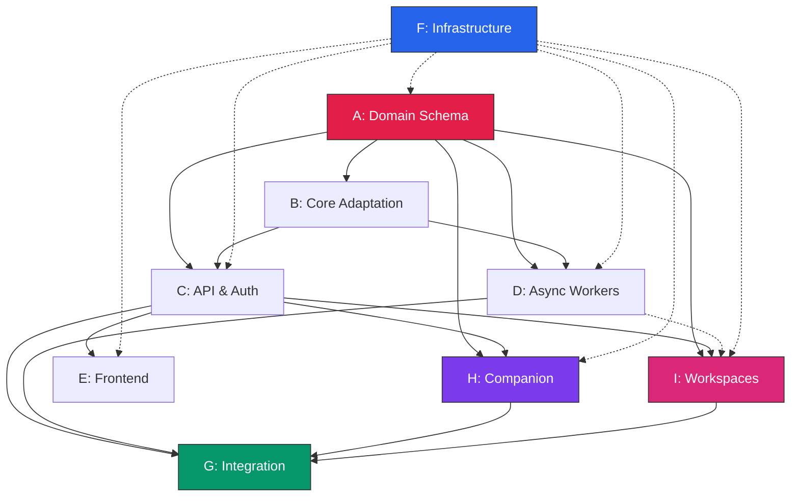

# Implementation Plan — Deku / Pos-Deku

**Cross-references**: [ARCHITECTURE.md](ARCHITECTURE.md), [DATA_MODEL.md](DATA_MODEL.md), [API_CONTRACT.md](API_CONTRACT.md), [INFRASTRUCTURE.md](INFRASTRUCTURE.md), [DECISIONS.md](DECISIONS.md), [ASSUMPTIONS.md](ASSUMPTIONS.md)

---

## 1. Workstream Overview

| ID | Workstream | Duration | Dependencies | Starts |
|----|------------|----------|--------------|--------|
| **A** | Domain Schema & Persistence | 3 weeks | — | Week 1 |
| **B** | Core Adaptation | 2 weeks | A (interfaces) | Week 3 |
| **C** | API & Auth | 2 weeks | A (repos), B (services) | Week 5 |
| **D** | Async Workers | 2 weeks | A (schema), B (extraction) | Week 5 |
| **E** | Frontend Integration | 2 weeks | C (contract), A (shapes) | Week 7 |
| **F** | Infrastructure | 3 weeks (parallel) | — | Week 1 |
| **G** | Integration & Quality | Ongoing | All | Week 5+ |
| **H** | Local Companion | 3 weeks | A (devices), C (auth), F (broker) | Week 5 |
| **I** | Cloud Workspaces | 3 weeks | A (workspace), C (API), F (IAM) | Week 5 |

---

## 2. Workstream Details

### Workstream A: Domain Schema & Persistence
**Scope**: 15 SQLAlchemy models, Alembic migrations, 10 repository interfaces + impls, revision triggers, conflict resolution, PostgreSQL persistence
**Deliverables**: `src/personal_os/db/**`, `alembic/**`, `tests/db/**`
**Acceptance**: Alembic works on PostgreSQL 16; revision triggers; optimistic locking; conflict function; FTS <100ms; export/import round-trip. SQLite application persistence is deferred and unsupported.

### Workstream B: Core Adaptation
**Scope**: Adapt `capture.py`, `processor.py`, `llm.py` to services+SQS; fix `get_provider`, `ProjectResolver` aliases; remove `vault.py` from core
**Deliverables**: Adapted core, `services/captures.py`, `services/processing.py`, tests
**Acceptance**: Persist-first → DB + SQS; full pipeline works; aliases injected; extraction tests pass

### Workstream C: API & Auth
**Scope**: FastAPI app, dual auth (user + device JWT), 14 route groups, RFC 7807 errors, contract tests
**Deliverables**: `src/personal_os/api/**`, `tests/contract/**`
**Acceptance**: 14 route groups; dual auth; optimistic lock 409; OpenAPI matches spec; all contract tests pass

### Workstream D: Async Workers
**Scope**: Capture worker (SQS FIFO), Workspace worker (SQS Standard), idempotency, retry/DLQ, graceful shutdown
**Deliverables**: `src/personal_os/workers/**`, `tests/workers/**`
**Acceptance**: Workers process messages; idempotency key prevents dupes; 3x retry + DLQ; graceful SIGTERM

### Workstream E: Frontend Integration
**Scope**: Typed API client, offline queue (IndexedDB), store migration for 6 pages, adapter for data shapes
**Deliverables**: `ui/src/lib/api-client.ts`, `blockday-api.ts`, `blockday-store-api.tsx`, `offline-queue.ts`
**Acceptance**: 6 pages load from API; mutations hit API; optimistic updates rollback on 409; offline queue syncs

### Workstream F: Infrastructure
**Scope**: Terraform (VPC, RDS, S3, SQS, Cognito, CloudFront, ACM, IAM, CloudWatch), CI/CD, deploy scripts
**Deliverables**: `terraform/**`, `.github/workflows/**`, `scripts/**`, `docs/DEPLOYMENT.md`
**Acceptance**: Terraform applies; EC2 healthy; RDS accessible; SQS processes; Cognito validates; CloudFront serves; deploy <2min

### Workstream G: Integration & Quality
**Scope**: E2E tests (capture→task, offline→online, companion terminal, workspace provision), load tests, deploy gates
**Deliverables**: `tests/integration/**`, `tests/performance/**`, `scripts/integration-test.sh`
**Acceptance**: E2E flows pass; load test 100 RPS p95<200ms; deploy gates enforce quality

### Workstream H: Local Companion
**Scope**: `pos-companion` daemon (device registration, heartbeat, WebSocket, authenticated online protocol client, approved RPC)
**Deliverables**: `companion/**`, `tests/companion/**`
**Acceptance**: Device registers/heartbeats; WS connects; RPC manifest served; approved methods work; path/command allowlists enforced; audit logged; revocation immediate. No disconnected durable queue is promised for the companion.

### Workstream I: Cloud Workspaces
**Scope**: Templates (devcontainer/Nix/script), provisioning worker, instance lifecycle, Git handoff, cost controls
**Deliverables**: `services/workspaces.py`, `workers/workspace_worker.py`, `terraform/aws/workspace.tf`
**Acceptance**: Provision→template→terminal→Git handoff; cost limits enforced; idle/max runtime; quota works; recovery branch created

---

## 3. Dependency Graph



---

## 4. Critical Path

```
A (3w) → B (2w) → C (2w) → E (2w) → G (1w) = ~10 weeks
              ↘          ↘
               D (2w)    H (3w) → G
                         I (3w) → G
```

**Critical Path**: A → B → C → E → G = **~10 weeks**  
H/I add ~3 weeks parallel after C

---

## 3. Parallel Workstreams

| Can Start Week 1 | After A (Week 3) | After C (Week 7) |
|------------------|------------------|------------------|
| F (Infrastructure) | B, C, D parallel | E, H, I parallel |
| | | G continuous |

---

## 4. Milestones & Gates

| Milestone | Target | Gate Criteria | Unlocks |
|-----------|--------|---------------|---------|
| **M1: Cloud-Backed Portal** | Week 5 | A+B+C+D done; 14 routes; contract tests; OpenAPI matches; dev infra deployed | E, H, I |
| **M2: Local Integration** | Week 8 | H done; device reg/heartbeat; WS connects; RPC manifest; authenticated outbound connection | G (sync) |
| **M3: Sync & Frontend** | Week 10 | E+H done; 6 pages from API; offline queue syncs; conflict UI works | G |
| **M4: Remote Access** | Week 11 | H done; RPC works; allowlists enforced; audit logged; revocation immediate | G |
| **M5: Cloud Workspaces** | Week 14 | I done; provision→template→terminal→Git handoff; cost limits; quota works | **Release Candidate** |

---

## 5. File Ownership Strategy

| Path | Owner | Notes |
|------|-------|-------|
| `src/personal_os/db/**` | A | Exclusive |
| `src/personal_os/core/**` | B | Exclusive (except extraction read-only) |
| `src/personal_os/services/**` | B/H/I | Per-domain |
| `src/personal_os/api/**` | C | Exclusive |
| `src/personal_os/workers/**` | D | Exclusive |
| `ui/src/lib/**` | E | Exclusive |
| `terraform/**` | F | Exclusive |
| `companion/**` | H | Exclusive |
| `tests/db/**` | A | Exclusive |
| `tests/core/**` | B | Exclusive |
| `tests/contract/**` | C | Exclusive |
| `tests/workers/**` | D | Exclusive |
| `tests/companion/**` | H | Exclusive |
| `tests/workspaces/**` | I | Exclusive |
| `tests/integration/**` | G | Exclusive |

**Coordination Protocol**:
1. A publishes repository interfaces by end of Week 1
2. B,C,D,H,I develop against interfaces with mocks until A delivers
3. Weekly 30-min sync for interface compliance
4. PRs to `main` with short-lived branches; squash merge
5. No direct edits to another workstream's files — open PR or request

---

## 6. Interface Contracts (Published Early)

| Interface | Publisher | Consumers | Stability |
|-----------|-----------|-----------|-----------|
| Repository interfaces (`db/repositories/interfaces.py`) | A | B, C, D, H, I | Frozen after M1 |
| API OpenAPI schema | C | E, H, I | Frozen after M1 |
| WebSocket JSON-RPC manifest | H | C, E | Frozen after M2 |
| Sync operation schema | C | E, H | Frozen after M1 |
| Workspace provisioning schema | I | C, D | Frozen after M2 |

---

## 7. First Release Scope (M1-M3)

**Minimum Useful Release**: Cloud-backed portal with local companion integration

| Included | Deferred to M4+ |
|----------|-----------------|
| Core portal (tasks, projects, captures, focus, stats) | Cloud workspaces (M5) |
| Device registration + heartbeat | Full companion RPC (process.exec, agent) |
| Capture processing pipeline | Advanced companion capabilities |
| Basic sync (tasks, captures) | Markdown document sync |
| Frontend connected to API | Session audit UI |
| Local companion daemon | Cloud workspaces |

---

## 8. Integration Checkpoints

| Checkpoint | When | Validates |
|------------|------|-----------|
| **IC-1: Schema Stable** | End of Week 3 | A complete; migrations verified on PostgreSQL 16; repo interfaces published |
| **IC-2: Pipeline Works** | End of Week 5 | B+D complete; capture→processing→DB verified |
| **IC-3: API Contract** | End of Week 7 | C complete; all contract tests pass; OpenAPI matches |
| **IC-4: Companion Connected** | End of Week 8 | H complete; device auth; WS; RPC manifest |
| **IC-5: Frontend Live** | End of Week 9 | E complete; 6 pages from API; mutations work |
| **IC-6: Sync Verified** | End of Week 10 | Offline→online reconciliation; conflict UI |
| **IC-7: Remote Terminal** | End of Week 11 | Companion RPC; capability checks; audit log |
| **IC-8: Workspace Provision** | End of Week 13 | I complete; provision→template→terminal→Git handoff |
| **IC-9: Release Candidate** | End of Week 14 | All E2E pass; load test baseline; deploy gates pass |

---

## 9. Risks & Fallbacks

| Risk | Likelihood | Impact | Fallback |
|------|------------|--------|----------|
| SQLite/application-schema divergence | Medium | High | Keep PostgreSQL canonical; do not use SQLite for application migrations or database-backed tests |
| Companion device auth complexity | Medium | High | Start with API key auth; migrate to Cognito device tracking |
| Workspace provisioning failures | Medium | Medium | Detailed logging; manual cleanup script; SQS DLQ for inspection |
| Real LLM integration testing | Low | Medium | PR-gated `pytest --run-real-llm`; mock-only for CI |
| Companion edits while disconnected | Medium | High | Companion sync actions require authenticated connectivity until a PostgreSQL-compatible durable edge outbox is approved and implemented |
| Cost overrun on cloud workspaces | Medium | Medium | Hard limits at API + CloudWatch alarms + instance metadata |
